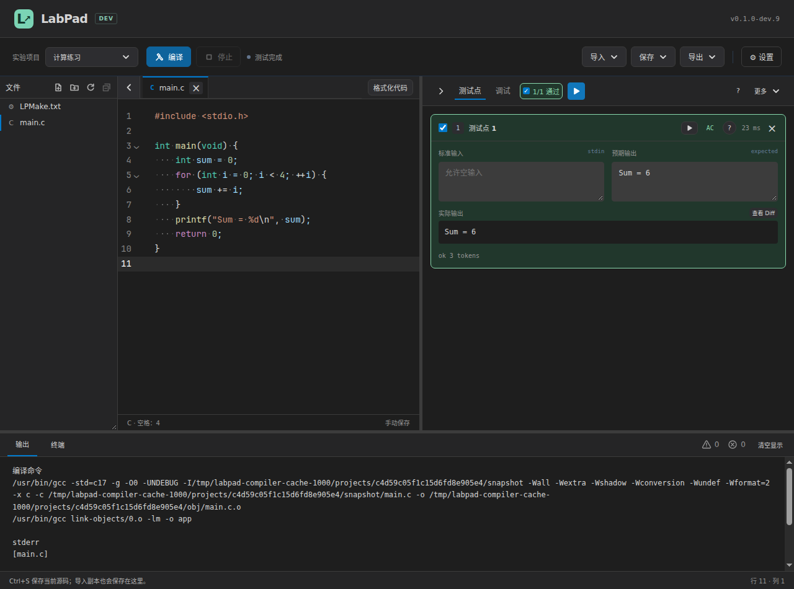
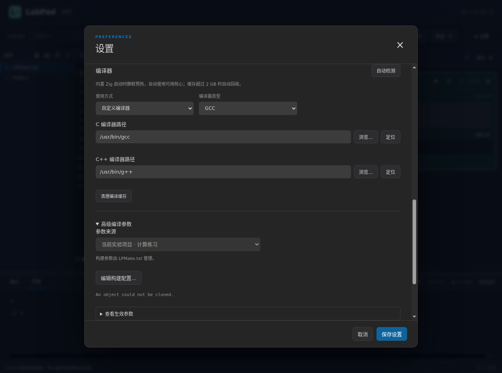
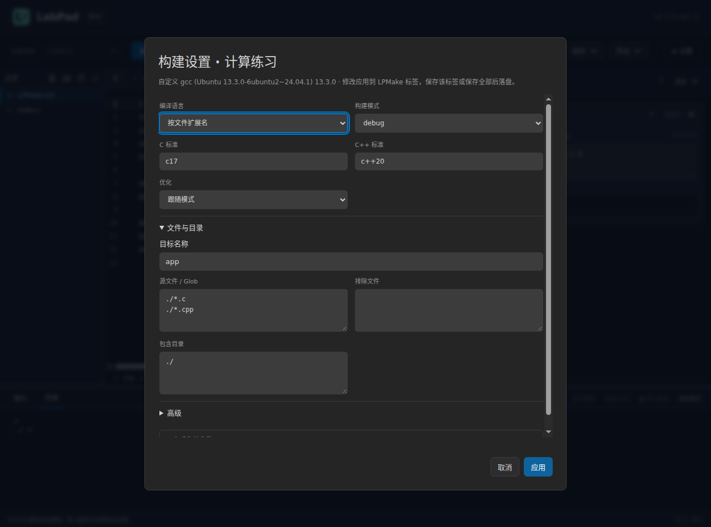

# LabPad

LabPad 是面向 C/C++ 程序设计实验的本地自测工具：导入课程项目、编写代码、比较测试输出，再导出源码或实验 ZIP。助教可用同一判题内核在命令行批量测试提交文件。

当前版本：**0.1.0-dev.9（预发布）**。[下载](https://github.com/XePWang/labpad/releases/tag/v0.1.0-dev.9) · [全部版本](https://github.com/XePWang/labpad/releases)

支持 Windows x64、Linux x64、macOS arm64。桌面包自带 Zig、离线格式化器和完整调试器，完整解压后启动即可。macOS 的签名及实机核验范围见[版本验证记录](doc/0.1.0-dev.9/verification.md)。

## 文档与快速开始

| 使用者 | 文档 |
| --- | --- |
| 同学 | [学生指南](doc/0.1.0-dev.9/student-guide.md)：下载安装、编写自测、源码版本、导出上传与 FAQ |
| 助教 | [助教指南](doc/0.1.0-dev.9/ta-guide.md)：项目 JSON、比较规则、批测、CSV 与补交 |
| 维护者 | [技术说明](doc/0.1.0-dev.9/maintainer-guide.md)：模块、存储、进程、构建与验证 |

1. 下载对应桌面包，完整解压并启动 LabPad。
2. 在“设置”中填写班号、姓名、学号。
3. “导入 → 导入实验项目”，选择课程 JSON。
4. 题集选择题号，多文件项目使用文件树；编写并保存后按 F9 或 Ctrl+Enter 编译，再点击“运行全部测试点”自测。没有测试点时，编译成功自动进入终端。
5. “导出 → 导出实验项目”，选择提交内容及是否附带配置，检查提醒，生成 ZIP 后上传课程平台。

完整构建语法及工程示例见 [LPMake 使用手册](doc/0.1.0-dev.9/lpmake-guide.md)。

## 编辑、调试与保存

- CodeMirror 6 提供 C/C++ 语法、上下文缩进、查找替换和独立撤销历史。空格显示为淡色小点，Tab 可设为 1 / 2 / 4 空格。
- 题集用标签管理同题多版本，多文件项目用标签管理实际文件；C/C++ 格式化按钮固定显示在标签栏右侧。文件标签前的 SVG 箭头开关侧栏；文件树可折叠、调整宽度，LPMake 与构建表单共享文本。
- “设置 → 编辑与保存”可分别选择中英文字体和字号（8–40）；英文默认使用随包 JetBrains Mono，中文默认使用本机中文字体。
- 手动保存默认开启；保存时默认使用离线 WASM clang-format，可在设置中调整。
- 源码统一导入为数据目录中的副本，保存当前 / 全部更新副本。题集切题打开最近五份，旧版本仍保留；多文件项目一次构建全部匹配源文件，使用已保存的源码、头文件和 LPMake 构建。
- 测试点可全部、部分、单点运行，也可定位及重测未通过项；颜色和简明说明帮助识别 AC、WA、CE、TLE、RE、OLE。
- “输出”保留原始编译与运行信息，并常驻警告、错误计数；“终端”内显示 > 和光标，支持行编辑、会话历史、中文输入、EOF 与中断。
- 编辑区与测试点、输出区之间可拖动调整；亮暗主题、25%–400% 的 16 档缩放、快捷键和自定义编译器均可设置。

顶部“编译”只读取已保存文件。有未保存源码或构建配置时，可选择“保存并编译”或取消；保存失败会停止编译。成功后，测试点栏的“运行全部测试点”变为蓝色，可重复运行、运行已选点或重测失败点，沿用同一程序。源码或编译配置变化后需要重新保存、编译；只改测试点可直接重测。没有测试点时自动进入终端。

调试输入与程序输出在同一终端中。历史仅保留在本次编译运行会话内，默认上限 65536 个 UTF-8 字节，超出时移除最旧的完整输入。Ctrl+C 有选区时复制，否则中断；Mac 还可用 Command+C 复制。常用行编辑键见学生指南。

数据默认保存在程序旁的 labpad 文件夹。设置中可选择已存在的空文件夹来迁移数据，并浏览编译器路径。Zig 启动时静默预热；多文件直接调用 zig cc/c++，与 GCC/Clang 共用有界并行编译及单次链接。缓存超过 2 GiB 自动回收，也可手动清理。首次编译仍可能准备不同模式或标准库。

Mac 默认使用 Command+S 保存、Command+Option+S 保存全部、Command+Option+F 替换；编译仍为 F9 / Control+Enter。Command+H、Command+Q 保留系统行为，详细默认键位及实测状态见指南。

## 编译设置

“设置 → 高级编译参数”显示当前采用的参数来源。题集可选择“全局配置（默认）”或“当前实验项目 · 项目名”；保存后切换实际来源，两组参数各自保留，切回即可恢复。课程 JSON 可预设项目参数，没有预设时采用全局配置。

项目的参数完全由 LPMake.txt 指定，来源下拉框锁定为当前项目；本机只选择编译器类型和路径。构建表单与 LPMake 编辑器共用一份文本，应用后保存该标签或保存全部即可，保存普通源码不顺带保存配置。

新建项目在根目录放置 main.c / main.cpp 和固定模板：C17 / C++20、Debug、根目录包含与源码模式、六项警告及数学库。个人全局参数不写入模板。导入缺少 LPMake 时，提示“原项目未提供 LPMake.txt，已填充默认模板”，可修改配置或忽略；原源码目录保持原样。默认模式只匹配根目录，递归需明确使用 **。

“查看生效参数”区分编译与链接，列出标准、模式、目录、宏和额外参数。明确冲突会阻止构建；覆盖及链接配对建议允许继续。

## 导入格式

### 实验项目

课程项目 JSON 由课程单独下发，仓库 examples 保留公开示例。

[实验1](examples/lab-1.project.json)包含 Lab 1-1、Lab 1-2、Lab 1-3；[实验2](examples/lab-2.project.json)包含 warmup 2-1 至 2-4、Lab 2-1 至 2-4；[实验3](examples/lab-3.project.json)包含 Lab 3-1 至 Lab 3-4。

~~~json
{
  "schemaVersion": 1,
  "kind": "labpad.project",
  "labId": "实验2",
  "problems": [
    {
      "problemId": "Lab 2-1",
      "language": "c",
      "source": ["#include <stdio.h>", "int main(void) {", "    return 0;", "}"],
      "comparison": {"type": "wcmp"},
      "testCases": [
        {"id": "morning", "input": "8\n", "expectedOutput": "good morning.\n"}
      ]
    }
  ]
}
~~~

题号按 problems 顺序显示，每题可选择 c/cpp。后续实验可通过 templates.c / templates.cpp 同时提供两套源码模板，初始语言由 language 决定；[双模板示例](examples/dual-templates.project.json)。source 支持完整字符串或逐行数组，省略时选用当前语言模板，未提供则使用默认模板；title 默认等于题号。时限默认 1000 ms，输出上限默认 65536 字节，测试点默认空数组。同名项目可建立副本，或只更新测试点及明确指定的规则；源码、模板和未保存编辑保留。

多文件项目使用 schemaVersion: 2、mode: "project"，工作区级 tests 和 files 数组；默认构建文件为 LPMake.txt。完整示例见 [multi-file.project.json](examples/multi-file.project.json)。题集 v1 保持兼容，v2 可显式写 mode: "problem-set"。

~~~text
target("app")
set_standard("c17")
set_standard("c++20")
set_mode("debug")
add_includedirs("./")
add_files("./*.c", "./*.cpp")
~~~

支持 C/C++ 混合、按语言设置标准、Glob、宏、库和原始参数；兼容单双引号、Lua 风格注释、set_languages、add_cxflags、set_kind("binary") 和 del_files 等常用写法。set_language 可明确覆盖扩展名语言；默认 debug，全量有界并行编译，Zig 复用原生缓存。命令和参数顺序见维护者指南。

课程示例提供编写起点与公开样例。Lab 1-2 使用固定虚构参数 x=12、y=8，修改个人参数后应同步修改预期输出；金字塔使用严格文本；回文素数配置 5000 ms。实验3的游泳接力、牛顿迭代各有 10 个自动测试点，食物搭配以一个完整测试核对全部七种解；猜数字游戏提供 10 项手动调试检查。选做牛顿迭代题在标签与数字之间保留空格，绝对、相对容差均为 1e-5，迭代计数约定见助教指南。输入回显不属于程序输出。详细格式见助教指南。

### 测试点

“导入 → 导入测试点”只更新当前题目。[求和示例](examples/sum.io.json)、[单点浮点覆盖示例](examples/mixed.io.json)：

~~~json
{
  "schemaVersion": 1,
  "kind": "labpad.testCases",
  "comparison": {"type": "wcmp"},
  "testCases": [
    {"id": "1", "input": "1 2\n", "expectedOutput": "3\n"}
  ]
}
~~~

可选择覆盖或追加测试点。覆盖时 comparison、timeLimitMs、outputLimitBytes 缺省则保留当前值；追加保留原点规则，将导入默认比较方式落实到新点，并预览重复编号改名。时限与输出上限可单独选择是否采用导入值。文件携带项目名或题号时，必须与当前目标一致。题目 JSON 不包含学生源码，源码与版本元数据分别持久化。

### 比较规则

- wcmp：按空白分隔 token 比较，保留提示语、标点及数值字面量，3.0 与 3.00 不同。
- floatTokens：数值满足绝对误差或相对误差任一条件即通过，其他 token 精确匹配。
- strictText：比较文本、缩进和换行，统一 CRLF/LF；默认保留行尾空白及末尾换行。

整题 comparison 提供默认值，每个测试点可以完整覆盖。例如：

~~~json
{
  "id": "pyramid",
  "input": "C\n",
  "expectedOutput": "  A\n ABA\nABCBA\n",
  "comparison": {
    "type": "strictText",
    "ignoreTrailingSpaces": true,
    "ignoreFinalNewlines": true
  }
}
~~~

两项默认 false，开启后分别忽略行末普通空格/Tab 和文件尾 LF；行首缩进、行内空格及正文空行仍比较。

~~~json
{"type":"floatTokens","absoluteTolerance":0.000001,"relativeTolerance":0.000001}
~~~

对标准值 e、实际值 a，满足 |a-e| ≤ A **或** |a-e| ≤ R×|e| 即通过。可只配置一项。

## 导出

“导出当前测试点 / 项目测试点”分别生成 labpad.testCases / labpad.projectTests，可通过原导入入口恢复测试集合。

“导出源码”生成当前文件。“导出实验项目”先展示题号与版本两层复选框，默认全选；取消题号取消本题全部版本，取消一个版本只减少该文件，部分选择显示半选。只有勾选版本参与预检和 ZIP。

未编辑、未全部通过及身份缺项会提醒；身份缺项可点击“前往设置”，保存后保留选择继续导出。同题多版本使用原名、_v2、_v3 后缀，列表预览最终文件名：

~~~text
9527_马冬梅_7355608_实验2.zip
└─ 9527_马冬梅_7355608_实验2/
   ├─ 7355608_Lab 2-1.c
   ├─ 7355608_Lab 2-1_v2.cpp
   └─ 7355608_Lab 2-2.c
~~~

多文件项目 ZIP 保留相对目录、文件名和 LPMake；只命名外层 ZIP 及其同名文件夹，保存窗口改名会同步到包内文件夹。“附带 LabPad 项目配置”在题集默认不选、多文件项目默认选；附带配置的 ZIP 可重新导入，恢复本次源码、版本与测试规则。项目下拉项右键可删除项目，经二次确认后移除该项目的托管数据。

空项目导出为“学号_空项目.c/.cpp”；未填写学号则为“空项目.c/.cpp”。上传由使用者在课程平台完成。

## 命令行批测

CLI Linux x64 包需要 Node.js 22+、GCC/G++ 或 Zig；直接复用桌面 Judge。实验目录采用 submit / src / build / output，[评分配置示例](examples/grade.json)指定项目、名单、隐藏测试与权重。

~~~sh
labpad judge --source solution.c --tests problem.io.json --compiler gcc
labpad judge --project ./workspace --tests project.json --compiler gcc
labpad grade lab2
labpad grade lab2 --student 7355608
~~~

题集按“学号 × 实验 × 题号”，多文件项目按“学号 × 实验 × 整份工程”完整测试所有版本，择最高分，同分按稳定来源顺序选择。summary.csv 按名单顺序输出有效文件、逐题通过数与百分制得分；cases.csv 输出采用版本的逐点结果。单人重测保留其他行与已有评语；评语由使用者在外部整理。

多文件收件接受完整目录或 ZIP，默认使用教师 LPMake 及测试，不拼接不同提交的文件。

Linux 批测默认使用 Bubblewrap；安装与环境预检、CSV 字段和可信夹具的直接运行方式见助教指南。

项目的右区提供断点调试，题集保留单文件编译；两种模式都有文件区、基础补全和命令终端。Tab 接受补全候选，Enter 仅在方向键明确选中后接受。调试允许编辑源码，重启前确认保存；参与会话的文件不能移动、重命名或删除。

终端 lpmake 只查当前目录的 LPMake.txt，build / run / clean 可简写 b / r / c；命令构建写当前目录 build/，GUI 编译仍用临时目录。测试点首行的运行图标按勾选范围执行。完整操作见学生指南。

## 版本更新

### 0.1.0-dev.9

相较 0.1.0-dev.8 的累计更新，更新日期：2026-11-08。

#### 新增

- **文件区**：项目与题集均可展开；新增刷新、多选与框选、拖动、打开、复制、剪切、粘贴和路径操作。
- **调试**：项目内置完整离线调试器，支持普通/条件断点、继续与暂停、单步、重启、变量、监视和调用堆栈。
- **字体与字号**：内置 JetBrains Mono；设置中分别调整中英文字体与字号，编辑器、补全提示和终端同步生效。
- **基础代码补全**：C17/C++20 关键词、可见声明、已包含的项目头文件声明、常用标准库函数名与签名，以及简短语句模板。
- **终端命令**：支持实验内文件命令及 lpmake build / run / clean（b / r / c）；命令只查当前目录的 LPMake.txt。
- **右区收起**：测试点和项目调试可切换、收起，保留选择、进度或运行状态提示。

#### 修改

- **编译与保存**：修复题集打开题目 JSON 后反复要求保存的问题；查看头文件或普通文本时保持所选源码目标；保存失败后可重试，启动失败或停止后及时恢复按钮与状态；后台刷新不会清空操作错误提示。
- **代码补全**：局部声明优先，按注释、成员访问和命名空间过滤候选；修正 std:: 重复插入、头文件局部名泄漏及强制语言下的候选；复用编辑器语法树并缓存头文件声明。
- **文本编码**：源码和资源保留原编码，保存失败保留原文件。
- **面板与主题**：左右收起保留分组、目录和宽度，统一动画及主操作颜色；隐藏区域退出键盘焦点，同名文件的撤销记录按实验隔离。
- **测试点**：运行与选择收进首行，显示“X/Y 已选 / 已完成 / 通过”；运行图标按当前勾选范围执行并显示对应提示；选中摘要默认透明，全通过后显示 AC 底框。
- **工具栏**：编译及调试使用统一 SVG 图标；项目移除顶部“新建源码”，通过文件区就地创建；开始调试与构建设置收进右区标题栏，运行提示点垂直居中。文件区底部移除“项目构建设置…”，可从实验项目选择框进入“构建设置…”。
- **终端**：底部“调试”更名为“终端”；修复提示符与异步输出重绘覆盖内容，切题及目录移动后显示实际工作目录，保留待输入内容、中文输入、会话历史与常用编辑键。
- **构建位置**：GUI 编译、自测与断点调试沿用临时目录；只有 lpmake 命令把产物写入当前配置目录的 build/，并按归属清理。
- **文件与资源**：移动同步标签、未保存内容、断点和终端目录；提交后的清理失败不会回退已成功的文件操作。导出、重建与 CLI 收件保留二进制资源，排除已识别的构建产物。
- **发布包**：三平台工具链仅携带本机目标资源，保留完整离线调试运行时；优化实际落盘文件数，归档格式延续原有平台习惯。
- **文档**：更新学生、助教、维护者指南、LPMake 手册及版本验证记录。

### 0.1.0-dev.8

相较 0.1.0-dev.7 的累计更新，更新日期：2026-11-02。

#### 新增

- **项目**：新建实验项目可选“项目”或“题集”；“项目”支持多文件共同编译，“题集”保留单题多版本。
- **文件树**：支持就地新建、重命名、删除文件与文件夹，以及“折叠全部文件夹”、F2 / Delete 操作。
- **LPMake.txt**：提供语法高亮、补全、构建设置表单和英文行列诊断；支持源文件匹配、宏、库及常用 Xmake 写法。
- **查看生效参数**：分别预览 C、C++ 和链接参数，提示参数覆盖与链接参数搭配，拦截输出位置、编译阶段等冲突参数。
- **测试点导出**：增加“导出当前测试点”“导出项目测试点”，导出的文件可重新导入。
- **诊断计数**：“输出”栏常驻警告、错误图标及数量，编译后刷新并短暂提示。
- **命令行项目评测**：支持单项目送测、完整目录 / ZIP 批测，默认采用教师构建配置与测试点，按整份项目择优。
- **示例与文档**：补充实验3、多文件项目和 C/C++ 双模板示例；新增 LPMake 使用手册，更新 dev8 学生指南、助教指南、技术说明及截图。

#### 修改

- **编译与自测**：顶部统一为“编译”（F9 / Ctrl+Enter），未保存时可选“保存并编译”；编译成功后通过“运行全部测试点”或“运行已选测试点”自测，无测试点时自动进入“调试”。
- **重复运行**：全部、单点及未通过项重测复用已编译程序；源码或构建配置变化后需重新保存、编译，修改测试点可直接重测。
- **高级编译参数**：“题集”可在“全局配置（默认）”“当前实验项目 · 名称”间切换，保存后生效，两组参数分别保留；“项目”由 LPMake.txt 管理，表单与文件共用保存、撤销。
- **默认编译配置**：统一采用 C17 / C++20；在 -Wall、-Wextra 基础上增加 -Wshadow、-Wconversion、-Wundef、-Wformat=2。
- **项目模板**：源码与 LPMake.txt 默认放在根目录，默认采用 debug 模式，包含当前目录并链接数学库；导入缺少 LPMake.txt 时填充默认模板并提示。
- **导入测试点**：由“导入标准 I/O”更名，支持覆盖、追加及重复编号预览；“导入实验项目”可按项目名、题号更新测试点与指定规则，保留源码、模板和未保存编辑。
- **导出实验项目**：增加“附带 LabPad 项目配置”，支持 ZIP 导入重建；“项目”保留内部文件名与目录，只命名 ZIP 及同名外层文件夹。
- **编辑区**：“格式化代码”常驻标签栏，标签前的 SVG 箭头展开 / 收起文件树；标签右键增加“在文件管理器中显示”。
- **调试**：输入改为终端内的 > 提示符和光标；支持行编辑、多行输入、会话历史及字节上限，完善中文、表情和异步输出；Ctrl+C 复制选区或停止程序。
- **实验项目选择**：下拉标注“项目”“题集”，支持右键进入“构建设置…”和“删除项目…”，删除前二次确认。
- **界面缩放与箭头**：“界面缩放”扩展至 25%–400% 共 16 档，展开时尽量居中当前值；Ctrl/Cmd+0 恢复 100%，统一下拉箭头样式。
- **快捷键与弹窗**：Windows、Linux、Mac 分别显示、录制和编辑实际键名；确认、取消按钮按对应系统顺序排列，统一 Esc 取消操作。
- **编译与资源回收**：Zig / GCC / Clang 支持 C/C++ 混合、并行编译和一次链接，按源文件顺序显示诊断；改善缓存复用，回收旧程序及临时目录，按实际生效配置判断是否需重测。

验证：115 项核心测试通过，Windows / Linux 最终包各通过 10 个完整场景；macOS arm64 完成构建、签名及资源核验，实机运行待测。详见 [dev.8 验证记录](doc/0.1.0-dev.8/verification.md)。

### 0.1.0-dev.7

- 合并编辑区重复标题；格式化操作移至标签栏，增加最近源码及恢复快捷键。
- 导出项目支持题号与源码版本两层复选、半选和多版本命名；补填身份后继续本次导出。
- 新增 strictText，可按题目或单点检查缩进、空格和换行。
- 增加选择/单点/失败项重测、整卡语义色、结果说明及题号测试状态；部分结果按源码及规则指纹合并。
- 调试增加独立 > 输入行；操作错误移除 Electron 包装文字，保留原始编译诊断。
- 按 macOS 常用约定完善默认快捷键及旧配置迁移。
- 新增 TypeScript CLI，支持目录/嵌套 ZIP、XLS/XLSX/CSV 名单、完整版本择优、隐藏测试、百分制与单人续测。
- 补充实验1、实验2完整项目示例和三份版本化指南。平台验证范围与完整流程证据见[验证记录](doc/0.1.0-dev.7/verification.md)。

### 0.1.0-dev.6

- 工具栏“新建源码”支持 C / C++；优先使用当前题目的对应语言模板，未预设时使用默认源码。关闭全部标签后，编辑区也保留新建入口。
- “导入”菜单依次提供源码、标准 I/O 和实验项目；源码统一导入为数据目录中的副本，旧版外部文件关联自动转为副本。
- 修正 Windows 调试页的 UTF-8 输入输出；源码支持 BOM 与 UTF-16，项目副本统一保存为 UTF-8。
- 每题支持多份源码及单编辑区标签页；保存当前 / 全部、标签右键菜单和独立撤销历史；切题打开最近编辑的五份源码。
- 新建项目与首题保留当前代码。
- F9 / Ctrl+Enter 运行、终端 Ctrl+C 中断；新增独立快捷键设置窗口和界面缩放。
- 启动后静默预热 Zig，实际任务优先；编译缓存自动回收和手动清理，回收遗留运行目录。
- 测试点可单独覆盖整题比较规则，支持部分或全部测试点使用浮点容差。
- 46 项核心测试、Windows / Linux 成品各七个桌面场景通过，覆盖中文交互、编码、多版本、快捷键、原子保存、导入导出和反复运行的资源回收。

### 0.1.0-dev.5

- 导入、导出改为下拉菜单，支持整个实验项目 JSON 导入及源码 ZIP 提交包。
- 导出前按题提示未编辑、未全部通过和身份信息缺项；记录测试对应的代码、规则及编译器，修改后需重新测试。
- 项目支持逐题 C/C++ 语言及外部源码关联；同名导入可建立副本，项目导入和导出文件使用原子操作。
- 状态栏精简为左右各一项，按操作短暂显示信息，扩充空闲提示；个人信息增加示例占位文字。
- Windows / Linux 隐藏系统菜单栏，设置页移除冗余提示；SVG 与各平台图标统一使用圆角箭头。
- 34 项核心集成测试、Windows / Linux 成品桌面回归通过，覆盖快捷键、原子撤销、导入导出、取消与写入失败、分栏布局及重启恢复。

### 0.1.0-dev.4

- 合并运行操作行，移除冗余说明；底部状态栏跟随光标、选区和操作更新，并轮换实用提示。
- 编辑器 / 测试点宽度与输出 / 调试高度均可拖动调整，支持分隔线方向键操作并保存布局；窄分栏自动适配，调试终端自动重排。
- 自定义编译器自动检测：扫描 PATH 和常用安装目录，由用户选择，自动适配类型、路径及默认参数。
- 路径设置统一使用“C 编译器路径 / C++ 编译器路径”。
- 25 项核心集成测试通过；Windows / Linux 最终包通过完整桌面回归，包括 12 组编辑器、5 组自动检测和 7 组布局检查。

### 0.1.0-dev.3

- 原生空格可视化，1 / 2 / 4 空格缩进，C/C++ 上下文自动缩进。
- 亮色 / 暗色主题，界面、编辑器和终端同步切换。
- 离线 WASM clang-format；格式化按钮、快捷键与默认开启的保存时格式化。
- 格式化原子撤销、跨文件历史隔离、原文件原子保存与并发编辑保护。
- 18 项核心测试，以及 Windows / Linux 发布包完整桌面测试、每平台 12 组编辑器检查通过。

### 0.1.0-dev.2

- 项目与题号下拉选择、新建、空项目导出及官方图标。
- 无测试点时自动进入交互调试；手动 / 自动保存及原文件写回。
- 数据目录迁移、编译器路径浏览和校验、持久化编译缓存。

### 0.1.0-dev.1

- 首个开发预发布：单文件 C/C++ 编译、自测、标准 I/O 导入、比较与 Diff、交互调试及源码导出。

## 开发与验证

~~~sh
cd pad
npm ci
npm run native
npm run tools -- linux-x64
npm run build
npm test
xvfb-run -a npm run test:ui
npm run cli -- --help
~~~

源码在 pad，构建与工具链在 .work。开发使用 Node.js 24；build 生成桌面、worker 与 CLI。工具链目标可选 linux-x64、win-x64、mac-arm64；设置 LABPAD_TEST_EXECUTABLE 可以测试实际发布包。构建、打包、运行时目录及文档维护约定见维护者说明。

项目采用 MIT；各依赖按其许可证分发。[第三方声明](pad/THIRD_PARTY_NOTICES.md)
