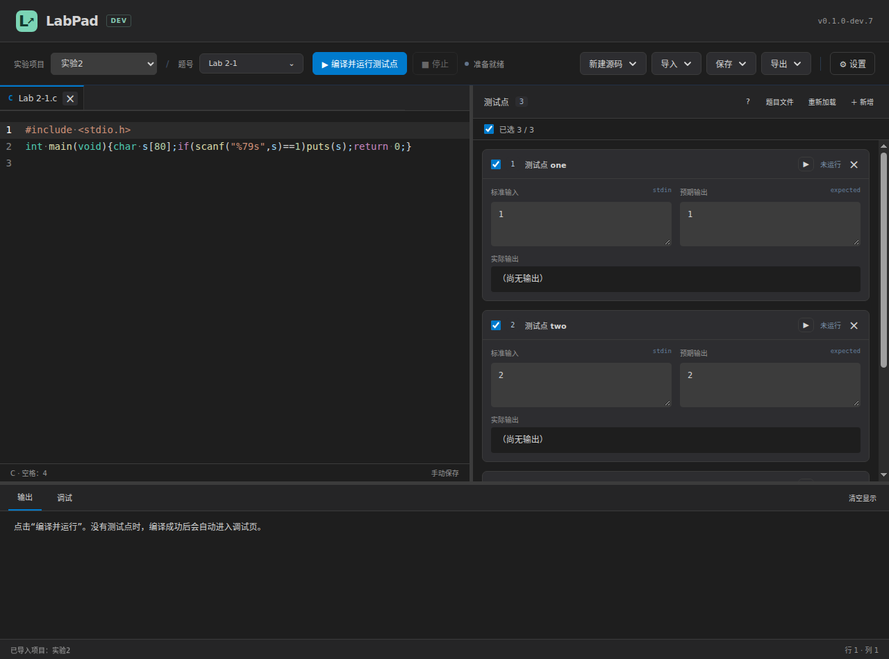
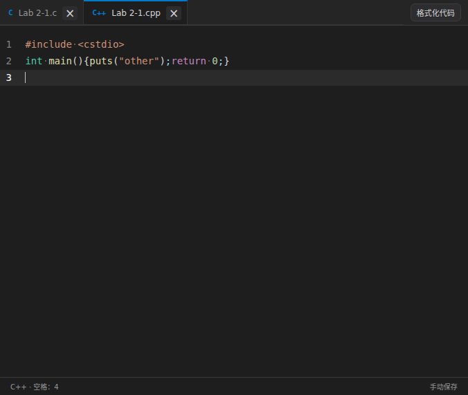
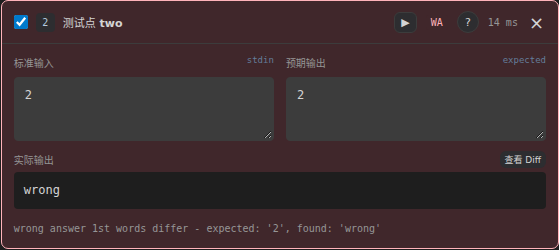
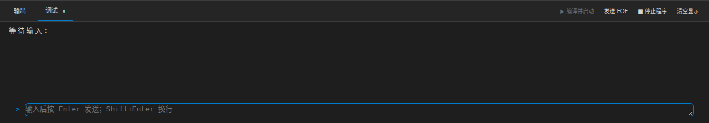
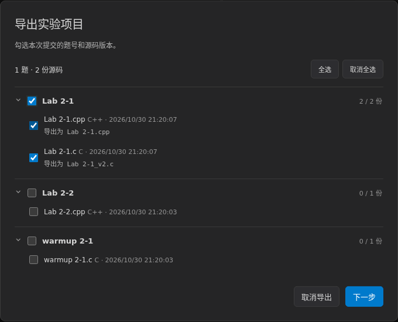

# LabPad 学生使用指南

适用版本：0.1.0-dev.7
撰写日期：2026-10-31
最近核验：2026-10-31；平台实测范围见[验证记录](verification.md)。

## 1. 下载并启动

在 [LabPad Releases](https://github.com/XePWang/labpad/releases/tag/v0.1.0-dev.7) 下载对应系统的桌面包：

| 系统 | 文件名中的平台 |
| --- | --- |
| Windows 64 位 | win-x64.zip |
| Linux 64 位 | linux-x64.tar.gz |
| Apple 芯片 Mac | mac-arm64.zip |

完整解压到有写入权限的文件夹，再启动 LabPad。Windows 启动 LabPad.exe；Linux 启动 LabPad；Mac 将应用放到可写位置后启动。保留同目录中的 resources、locales 等运行文件。

程序自带 Zig C/C++ 编译器，可以直接完成实验。更新时先关闭程序并备份数据，将新版本解压到另一个文件夹，再将旧程序旁的 labpad 文件夹复制到新程序旁后启动。使用自定义数据目录时，同时保留其中的 location.json 指向记录。程序默认会在自身旁边建立 labpad 文件夹；Mac 对应应用包旁边。

## 2. 设置个人信息

点击右上角“设置”，填写班号、姓名、学号，点击“保存设置”。这些内容用于生成提交文件名。示例：班号 9527、姓名 马冬梅、学号 7355608。

保存方式默认手动；按 Ctrl+S 保存当前文件，或从“保存”菜单选择“保存当前 / 保存全部”。Mac 使用 Command+S，保存全部使用 Command+Option+S。保存时自动格式化默认开启，可在“编辑与保存”中关闭。Tab 的空格数、亮暗主题和界面缩放也在这里设置。

## 3. 导入本次实验

选择“导入 → 导入实验项目”，打开课程提供的项目 JSON。导入成功后，实验项目和题号出现在左上角下拉列表，源码模板及公开测试点同时就位。

图：Linux 桌面示例。Windows 使用相同的菜单和操作顺序。

完整项目已经包含测试点时，导入一次即可。“导入 → 导入标准 I/O”只替换当前题目的测试点，适用于助教补发的单题测试文件。导入时选错类型，按错误提示重新选择菜单即可，当前源码会保留。

项目“实验2”下的题号包括 warmup 2-1 至 warmup 2-4、Lab 2-1 至 Lab 2-4。同名项目再次导入时，可取消，或建立“实验2 (2)”这样的副本。

## 4. 编写与管理源码

先确认当前题号，再编写代码：

- “新建源码”可选 C 或 C++；优先使用本题预设模板。
- “导入 → 导入源码”将文件复制到当前题目，后续修改和保存针对该副本，原文件保留。
- 同一题可以保存多个版本。点击标签切换，右键可关闭、关闭其他、关闭右侧、关闭已保存、全部关闭、另存为新版本及复制路径。
- 关闭标签只收起编辑视图，已经保存的源码仍在数据目录。关闭未保存文件时，按提示选择保存、放弃或取消。
- 切换题号后打开该题最近编辑的最多五份源码。更多旧版本可通过导入重新打开；导入本题已有文件会激活原版本。
- 全部标签关闭后，可点击“新建源码”或“最近源码”；Ctrl+Shift+T 恢复最近源码。放弃的未保存修改不会因此恢复。

编辑器用淡色圆点显示空格，导出文件仍是普通空格。Tab 输入设定数量的空格；选中多行时，Tab / Shift+Tab 调整整块缩进。回车按 C/C++ 上下文自动缩进。

“格式化代码”位于标签栏右侧：编辑时显示，查看标签时收起；键盘聚焦按钮时也会显示。格式化使用离线 clang-format，Shift+Alt+F 可以直接调用，Ctrl+Z 可整次撤销。

## 5. 自测与查看结果

有测试点时，点击“编译并运行测试点”，或按 F9 / Ctrl+Enter。默认运行全部测试点，也可以勾选部分，或点击某个测试点的运行按钮。一次任务只编译一次。

| 结果 | 含义与下一步 |
| --- | --- |
| AC · 通过 | 本测试点输出符合规则 |
| WA · 答案不符 | 打开 Diff，对照预期与实际输出 |
| CE · 编译失败 | 到下方“输出”页查看文件、行号和编译诊断 |
| TLE · 运行超时 | 检查循环、退出条件和算法耗时 |
| RE · 运行异常 | 查看退出信息，检查越界等问题 |
| OLE · 输出过多 | 检查是否反复输出，超过题目限制 |

结果旁的“?”可以随时查看简明说明。卡片颜色帮助定位，具体结论以文字为准。“定位未通过”跳到失败点，“重测未通过”只运行失败点。

部分测试通过时，题号显示“部分已测”。同一份代码及相同规则下，分次运行可以补齐全部结果。修改源码、测试点、比较规则或编译器后，需要重新测试；题号会显示“需重测”。导出前建议运行一次全部测试点。

标准输出是程序写出的内容。终端中键盘输入的回显、指导书里的回车箭头均不应写入预期输出。提示语、大小写、中文和标点也参与比较。

实验2的字母金字塔使用严格文本规则，行首普通空格和每行内容必须正确。一般题目使用空白分隔 token 比较；浮点题是否有容差，以题目 JSON 为准。

## 6. 交互调试

没有测试点时，编译成功后自动进入下方“调试”页；编译失败则留在“输出”页。有测试点时也可切到“调试”，点击“编译并启动”。

在“>”右侧输入内容，按 Enter 发送；Shift+Enter 在输入框内换行。“>”是界面提示符，不会传给 C/C++ 程序。程序持续输出时，待发送输入保留在独立输入行。

点击“停止程序”或在输入区按 Ctrl+C 可中断。存在文本选区时，Ctrl+C 优先复制选区。发送 EOF 表示输入已经结束，适合读取到文件结尾的程序。程序退出后，输入框自动停用。

## 7. 导出并提交

完成自测后选择“导出 → 导出实验项目”：

1. 在两层列表中勾选题号和源码版本，默认全部选中。
2. 取消题号会取消其全部版本；取消一个版本只减少该文件。题号半选表示只选了部分版本。
3. 点击“下一步”，检查未编辑、未全部通过及身份缺项提醒。只检查本次所选文件。
4. 身份缺项时点击“前往设置”，填写并保存后继续本次导出，选择会保留。其他提醒仍需确认。
5. 选择保存路径，得到 ZIP。解压检查文件，再按课程要求上传到指定平台。

单个版本的文件名为“学号_题号.c”或 .cpp。同题选中多个版本时，列表会预览原名及 _v2、_v3 等后缀。提交包中每份源码都是独立文件。

例如：

~~~text
9527_马冬梅_7355608_实验2.zip
└─ 9527_马冬梅_7355608_实验2/
   ├─ 7355608_Lab 2-1.c
   ├─ 7355608_Lab 2-1_v2.cpp
   └─ 7355608_Lab 2-2.c
~~~

只导出当前文件时，选择“导出 → 导出源码”。未填写身份仍可继续导出；空项目按“空项目.c/.cpp”命名，有学号则加学号前缀。

“保存”更新 LabPad 数据目录中的版本；“导出”生成交给课程平台的文件。保存后仍需要完成导出和上传。

## 8. 可选：使用 MinGW-w64 / GCC

课程要求 GCC 时，可独立安装 MinGW-w64，无需安装整个 IDE：

1. 打开 [MinGW-w64 下载页](https://www.mingw-w64.org/downloads/)，选择适用于 Windows x64 的发行包，例如 [WinLibs](https://winlibs.com/) 的 UCRT x86_64 GCC 包。
2. 完整解压到仅含英文、数字的路径，例如 C:\Tools\mingw64，保留 bin、lib、include 等目录。找到 bin/gcc.exe 和 bin/g++.exe。部分 MinGW 链接器不能处理安装路径中的中文，会报找不到 crt2.o。
3. 打开 LabPad 设置，将“使用方式”改为“自定义编译器”。
4. 点击“自动检测”，选择扫描到的 GCC；未找到时，分别浏览或输入两个可执行文件的完整路径。
5. 类型选择 GCC，使用检测生成的默认参数，点击“保存设置”。
6. 新建 C 程序和 C++ 程序，各编译运行一次，确认两个编译器均可用。

本版已在 Windows 实测 WinLibs GCC 14.2.0、MinGW-w64 12.0.0 UCRT，覆盖自动检测、C/C++ 编译及中文交互。安装目录使用英文路径。

LabPad 使用所选编译器的完整路径；系统 PATH 可以按需要另外配置。路径不存在时，字段下方显示红色提示，修正后才能保存。

## 常见问题

**第一次编译较慢。** Zig 会建立缓存，程序启动时也会静默预热。后续使用相同工具链通常更快。设置中的“清理编译缓存”会使下次编译重新建缓存。

**一直等待输入。** 检查程序需要几个数、是否等待换行、是否读到 EOF。可以发送 EOF 或停止程序。

**测试点通过，换一份代码却不能直接提交通过记录。** 测试结果对应具体源码版本；每份版本都要分别运行。

**Lab 1-2 换成自己的参数后不通过。** 示例使用固定虚构参数 x=12、y=8，输入为空。按指导书修改源码参数后，需要同步修改预期输出，并自行验算。

**温度答案差一点。** 按题目要求保留两位小数。只有题目明确配置了浮点容差时，才会按容差比较。

**导入后出现乱码。** 源码导入支持 UTF-8、带 BOM 的 UTF-8、UTF-16 和 GBK；副本保存为 UTF-8。若文件无法完整识别，先用编辑器另存为 UTF-8 后导入。

**Mac 拦截首次打开。** 确认文件来自本仓库发布页后，按系统“隐私与安全性”中的提示处理。dev 包采用 ad-hoc 签名，尚未公证；Mac 实机状态见验证记录。[Apple 说明](https://support.apple.com/guide/mac-help/open-a-mac-app-from-an-unknown-developer-mh40616/mac)

**想找回数据。** 设置中的“数据位置”可定位文件夹。projects 下按实验保存源码和题目；备份整个数据目录即可。
