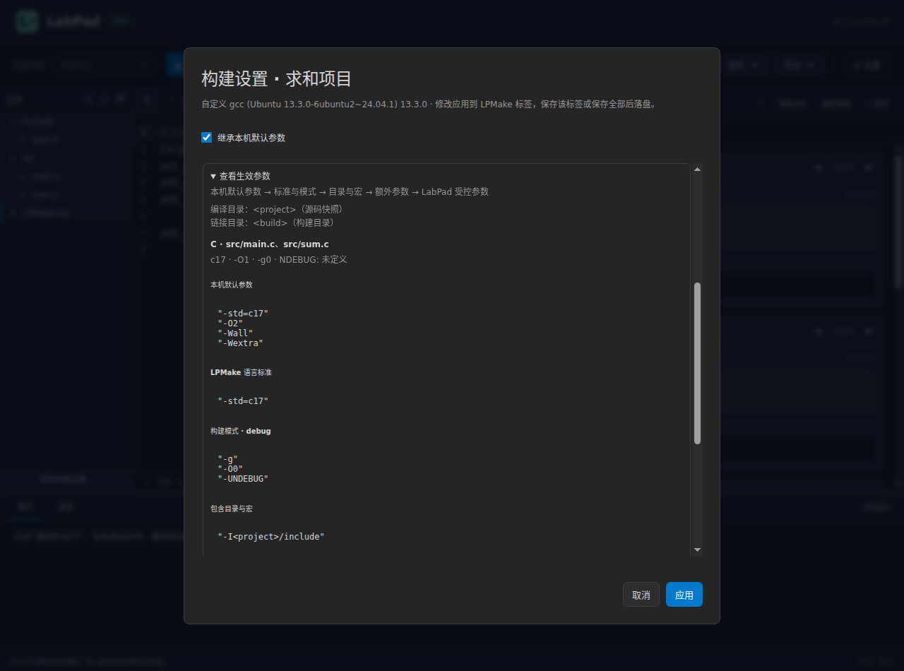
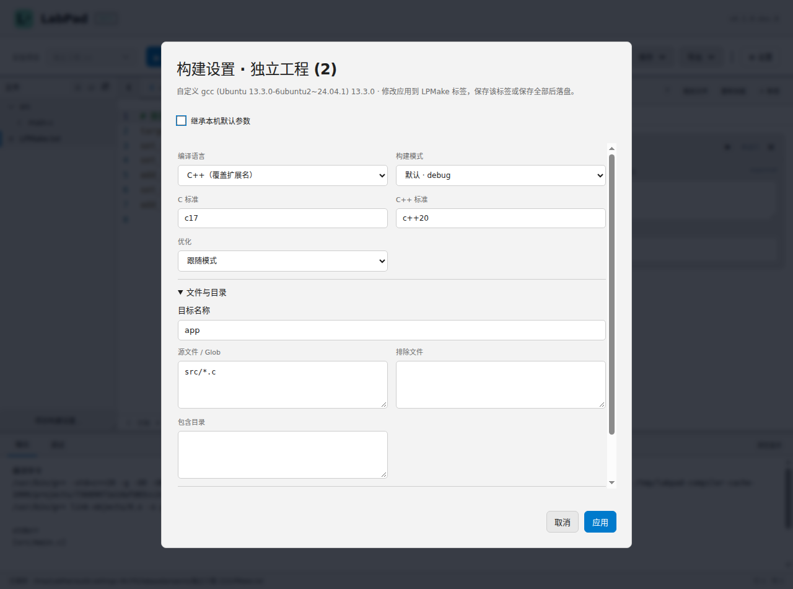

# LPMake 使用手册

适用版本：LabPad 0.1.0-dev.8

撰写日期：2026-11-01

更新日期：2026-11-02

LPMake 用来说明一个多文件实验中要编译哪些文件、使用什么语言标准和参数。它放在项目根目录，文件名为 **LPMake.txt**。LabPad 读取它构建一个可执行程序，再用项目测试点自测或进入交互调试。

新建项目默认 C17 / C++20。set_standard() 可明确选择课程要求的其他标准；关闭本机参数继承时，缺省语言标准仍为 C17 / C++20。

## 1. 从一个 C 项目开始
文件结构：

~~~text
LPMake.txt
include/
  sum.h
src/
  main.c
  sum.c
~~~

LPMake：

~~~text
# src 中新增的 C 文件会自动参与构建
target("sum")
set_standard("c17")
add_includedirs("include")
add_files("src/*.c")
~~~

include/sum.h：

~~~c
#ifndef SUM_H
#define SUM_H
int sum(int a, int b);
#endif
~~~

src/sum.c：

~~~c
#include "sum.h"
int sum(int a, int b) { return a + b; }
~~~

src/main.c：

~~~c
#include <stdio.h>
#include "sum.h"

int main(void) {
    int a, b;
    if (scanf("%d%d", &a, &b) != 2) return 1;
    printf("%d\n", sum(a, b));
    return 0;
}
~~~

给程序输入 1 2，应输出 3。完整的可导入项目见 [multi-file.project.json](../../examples/multi-file.project.json)。

在“新建项目”中选择“项目”，或直接导入教师 JSON。点击文件树中的 LPMake.txt 可编辑文本；“项目构建设置…”提供对应表单，应用后写入同一个编辑缓冲。

## 2. 基本语法
每条声明由命令名、括号和双引号字符串组成：

~~~text
命令名("参数1", "参数2")
~~~

支持：

~~~text
# 整行注释
target("app") # 行尾注释

add_files(
    "src/main.c",
    "src/helper.c", # 参数后的注释
)
~~~

- # 在字符串外表示注释，直到行尾；字符串内的 # 是普通字符。
- 参数之间用英文逗号分隔；最后一个参数后可以保留逗号。
- 空格、空行和换行用于排版。每条声明不需要分号。
- 字符串使用双引号及 JSON 转义规则，例如 \"、\\、\t、\u4E2D。
- 不使用变量、算术表达式、循环、条件块、函数定义或执行命令的钩子。
- 命令名和参数值区分大小写；未知命令、重复单值声明和错误参数会报告行列。
- LPMake 不进入 C/C++ 格式化器。编辑器提供 # 注释、高亮、缩进和命令补全。

这些内容有不同含义：

~~~text
add_defines("LABEL=\"hello world\"") # 一个宏参数，值是 C 字符串
add_defines("TEXT=#inside")          # # 属于参数
add_files("src/*.c", "common/*.c")   # 两个文件模式
~~~

## 3. 14 条命令速查
| 命令 | 参数 | 用途 |
| --- | --- | --- |
| target | 一个目标名，必填 | 定义唯一可执行目标 |
| set_language | "c" 或 "c++" | 显式覆盖源文件扩展名对应的语言 |
| set_standard | 一个标准名 | 设置 C 或 C++ 标准 |
| set_mode | "debug" 或 "release" | 设置基础构建模式 |
| set_optimize | "O0"、"O1"、"O2"、"O3"、"Os" | 覆盖优化级别 |
| add_files | 一个或多个路径/Glob | 添加参与编译的源文件 |
| remove_files | 一个或多个路径/Glob | 从最终源集合排除文件 |
| add_includedirs | 一个或多个目录 | 增加头文件搜索目录 |
| add_defines | 一个或多个宏 | 增加预处理宏定义 |
| add_linkdirs | 一个或多个目录 | 增加库搜索目录 |
| add_links | 一个或多个库名 | 按声明顺序链接库 |
| add_cflags | 一个或多个参数 | 追加 C 编译参数 |
| add_cxxflags | 一个或多个参数 | 追加 C++ 编译参数 |
| add_ldflags | 一个或多个参数 | 追加链接参数 |

所有命令至少有一个参数。target、set_language、set_mode、set_optimize 各最多声明一次。set_standard 的 C、C++ 两类标准各最多一条；其余命令可以重复，按声明顺序累计。

## 4. 目标、语言和标准
### target
~~~text
target("calculator")
~~~

目标名允许字母、数字、下划线和连字符，不包含路径或空白。一个实验项目只有一个可执行目标。平台需要的 .exe 后缀由 LabPad 处理，不写进目标名。

### set_language
不写时：

| 扩展名 | 编译语言 |
| --- | --- |
| .c | C |
| .cpp、.cc、.cxx | C++ |

写了 set_language 后，所有参与编译的源文件按指定语言处理：

~~~text
target("force_cpp")
set_language("c++")
set_standard("c++20")
add_files("src/*.c")
~~~

即使后缀是 .c，这里也按 C++20 编译，并使用 C++ 链接驱动。set_language("c") 同理可让 .cpp 按 C 编译。取值是 "c++"，不是 "cpp"。头文件通过 #include 使用，不加入 add_files。

### set_standard
~~~text
set_standard("c17")
set_standard("c++20")
~~~

两条可以共存，分别作用于 C 和 C++ 单元。同类重复声明会报错，例如同时写 c11 和 c17。

解析器识别：

| 语言 | 标准 |
| --- | --- |
| C | c89、c90、c99、c11、c17、c23 |
| GNU C | gnu89、gnu90、gnu99、gnu11、gnu17、gnu23 |
| C++ | c++11、c++14、c++17、c++20、c++23 |
| GNU C++ | gnu++11、gnu++14、gnu++17、gnu++20、gnu++23 |

具体标准还需所选编译器支持。未指定的语言槽使用允许继承的本机标准；没有明确标准时兜底为 C17 / C++20。关闭参数继承也保留这两个语言默认值。

## 5. debug、release 和优化
~~~text
set_mode("debug")
set_optimize("O2")
~~~

| 设置 | 生效的基础参数 |
| --- | --- |
| 缺省或 debug | -g -O0 -UNDEBUG |
| release | -O2 -DNDEBUG |
| debug + set_optimize("O2") | 保留 -g，优化采用 -O2 |
| release + set_optimize("O0") | 保留 -DNDEBUG，优化采用 -O0 |

优化覆盖只接受 O0 / O1 / O2 / O3 / Os。"debug" 是 set_mode 的取值，不是 set_optimize 的取值。

## 6. 文件、Glob 和路径
~~~text
add_files("src/*.c", "common/helper.c")
add_files("modules/**/*.cpp")
remove_files("src/experimental_*.c", "modules/tests/**")
~~~

- * 匹配当前目录层级；** 可跨越子目录。
- 显式路径可以直接列举，例如 add_files("src/main.c", "src/stack.c")。
- 最终源集合是所有 add_files 的并集，再减去全部 remove_files；排除优先，与声明先后无关。
- 重复源文件只编译一次，按规范化相对路径稳定排序。
- 显式列出的文件必须存在；整个有效源集合为空时不能构建。
- 新增文件匹配 Glob 后自动参与构建，无需修改 LPMake。
- 当前源码未匹配或被排除时，编辑区会显示“当前源码未参与构建”。
- 使用 / 相对项目根目录，不使用绝对路径、.. 或越界链接。跨平台文件名及目录大小写保持一致。

包含目录和库目录必须存在。项目根目录可以写为 "."：

~~~text
add_includedirs(".", "include", "modules/include")
add_linkdirs("lib")
~~~

包含目录按声明顺序去重，搜索顺序保留。源文件排序不会改变头文件或库的搜索次序。文件树重命名时，可以同步修改 LPMake 中对应的显式路径；Glob 通常无需改写。

## 7. 宏定义
~~~text
add_defines("MAX_BUF=4096", "USE_FAST_MATH")
add_defines("MESSAGE=\"hello world\"")
~~~

宏名使用 ASCII 字母、数字、下划线，首字符不能是数字。值可以包含空格和引号。每个字符串作为一个独立参数传给编译器，不经过 shell 拆分。

以下写法会报错：

~~~text
add_defines(" USE_FAST_MATH") # 宏名前多了空格
add_defines("3D_MODE")        # 宏名以数字开头
~~~

## 8. 库和原始参数
~~~text
add_links("m")
add_cflags("-Wall", "-Wextra")
add_cxxflags("-Wall", "-Wextra")
add_ldflags("-pthread")
~~~

add_links("m") 对应链接参数 -lm。库和原始参数保留声明顺序及重复项，不能按字母排序；依赖库通常放在使用它的对象/库之后。

每个原始参数单独写一个字符串：

~~~text
add_cflags("-Wall", "-Wextra") # 两个参数
~~~

不要把两个参数合并为 "-Wall -Wextra"。需要“选项 + 值”时同样拆开，例如 add_cflags("-include", "include/config.h")。源码、有效语言和输出位置由 LabPad 安排。

线程示例，适用于工具链提供 pthread 的课程环境：

~~~text
add_cflags("-pthread")
add_cxxflags("-pthread")
add_ldflags("-pthread")
~~~

只写 add_links("pthread") 不能替代编译阶段的线程选项。额外库仍需在所选工具链环境中安装；LPMake 不下载依赖。当前项目 JSON 和编辑工作区面向文本文件，二进制第三方库不作为源码字符串下发。各平台支持的库及原始选项以实际编译器为准。

## 9. 参数优先级
每个编译单元按以下顺序合成参数，后面的同类选项可以覆盖前面的选项：

1. 本机默认参数，仅在“继承本机默认参数”开启时加入。
2. 对应语言的 set_standard。
3. set_mode 的基础模式。
4. set_optimize。
5. add_includedirs 和 add_defines。
6. 对应的 add_cflags 或 add_cxxflags。
7. 程序安排的有效语言、源码和对象位置。

例如：

~~~text
target("priority")
set_standard("c17")
set_mode("debug")
set_optimize("O3")
add_cflags("-O0")
add_files("src/*.c")
~~~

即使本机默认是 C17、O2，这里仍按 C11 编译，最终优化级别为 O0，保留 debug 的调试符号。-I、库等累加选项仍遵循各自的顺序规则。

继承开关位于当前实验的“构建设置…”窗口，也可通过项目 JSON 的 build.inheritDefaults 下发。应用设置中的“本机默认参数”只编辑默认数组。继承不是一条 LPMake 命令；关闭继承会排除本机数组，保留 LPMake 自身的标准、模式、宏和原始参数。

展开“查看生效参数”，可以按来源核对每一步追加的参数。标准或优化被后续额外参数覆盖时，字段旁显示提示；目录和库仍按原次序累加。

## 10. C++ 项目
~~~text
target("hello_cpp")
set_standard("c++20")
add_files("src/*.cpp")
~~~

src/main.cpp：

~~~cpp
#include <iostream>
#include <string>

int main() {
    std::string message = "hello";
    std::cout << message << '\n';
}
~~~

## 11. C/C++ 混合项目
~~~text
target("mixed")
set_standard("c17")
set_standard("c++20")
add_includedirs("include")
add_files("src/*.c", "src/*.cpp")
~~~

include/calc.h：

~~~c
#ifndef CALC_H
#define CALC_H
#ifdef __cplusplus
extern "C" {
#endif
int twice(int value);
#ifdef __cplusplus
}
#endif
#endif
~~~

src/calc.c：

~~~c
#include "calc.h"
int twice(int value) { return value * 2; }
~~~

src/main.cpp：

~~~cpp
#include <iostream>
#include <string>
#include "calc.h"

int main() {
    std::string label = "result";
    std::cout << label << ": " << twice(21) << '\n';
}
~~~

.c 使用 C11，.cpp 使用 C++20。存在有效的 C++ 单元时，LabPad 选择 C++ 链接驱动和标准库；C 接口通过 extern "C" 与 C++ 调用方衔接。

## 12. 编辑、保存、运行和导出
LPMake 文本和构建表单共享缓冲。表单应用会保留注释，整次改动可撤销。手动保存模式下，F9 使用本次未保存的源码、头文件及 LPMake 快照，不自动保存全部文件；解析失败时先修复错误，再重新运行。

Zig 直接通过 zig cc / zig c++ 构建并复用受控缓存；GCC/Clang 采用有界并行编译后一次链接。重复运行可能命中 Zig 缓存，首次标准库或模式准备仍可能较慢。

导出整个项目时，LPMake 与源码一起提供：

~~~text
提交名称.zip
└─ 提交名称/
   ├─ LPMake.txt
   ├─ include/
   │  └─ calc.h
   └─ src/
      ├─ main.cpp
      └─ calc.c
~~~

只命名 ZIP 和同名外层文件夹，内部源码、头文件和 LPMake 保持原名。“附带 LabPad 项目配置”另行控制测试点及重建信息。

## 13. 常见错误
| 提示或现象 | 检查与处理 |
| --- | --- |
| Unexpected token / Unexpected end of file | 检查英文括号、双引号、逗号及未闭合字符串 |
| Unknown command | 对照命令表；add_includedirs 中间没有空格 |
| 重复声明 standard:c | 保留一条 C 标准；C++ 标准可另写一条 |
| No source files remain in the build | 检查 add_files、扩展名、Glob 层级与 remove_files |
| Source file ... does not exist | 修正显式路径或同步重命名引用 |
| 包含/库目录不在项目内 | 使用存在的项目内相对目录 |
| 找不到头文件 | 检查 #include 名称、目录大小写和 add_includedirs |
| 多次定义 main | 多文件模式只保留一个 main，排除独立试验入口 |
| 未定义符号 | 检查实现文件是否参与构建、C/C++ 接口和库次序 |
| 修改源码后输出没变 | 查看“未参与构建”提示及输出中的实际编译单元 |
| 保存后格式不变 | LPMake 不使用 clang-format；可通过构建设置调整声明 |

完整实验操作见[学生指南](student-guide.md)，项目下发和批测见[助教指南](ta-guide.md)，实现及验证见[技术说明](maintainer-guide.md)。

## 诊断格式
LPMake 诊断使用英文，给出文件、行列、源码及定位指针。已识别的修正建议显示为 hint，相关上下文显示为 note；两者按需出现。

~~~text
LPMake.txt:2:14: error: Unsupported language "cpp".
  2 | set_language("cpp")
    |              ^~~~~
  hint: Use set_language("c") or set_language("c++").
  note: Omit set_language() to infer the language from each source extension.
~~~

修正上例中的 cpp 为 c++ 后重新运行。缺失文件、目录、未匹配源文件及重复声明也会定位到对应配置；源码中的 Tab 在诊断显示中展开为 4 个空格。

## 构建设置、参数诊断与保存

展开实验选择框后，底部的“构建设置…”打开当前实验配置；也可右键选择框或实验列表项，项目文件树底部保留同一入口。

项目表单打开 LPMake 标签，基础字段和“高级”字段对应同一份文本。应用后，文本或继承开关只要有一项变化，标签就显示未保存。保存该标签或保存全部，会一起保存两项；保存普通源码只更新该源码。放弃配置标签会同时恢复文本和继承选项。文本撤销使用编辑器原有历史，继承开关的未保存状态单独比较。

### 参数边界与错误

每个字符串代表一个进程参数。例如：

~~~text
add_cflags("-Iinclude", "-include", "config.h", "-DMSG=hello world")
~~~

-include 与 config.h 是两个参数；-DMSG=hello world 是一个完整参数。不会按空格自动拆成 shell 命令。

独立 -o / --output、-c / -S / -E、-M / -MM，以及独立 -x / --language 和明确的 -xc / -xc++ / -xnone，会与 LabPad 管理的构建流程冲突，应移除；项目语言用 set_language 设置。已识别的有值选项位于列表末尾时，会指出缺少下一项。

这些检查按选项边界处理，不按无例外前缀匹配。-MD / -MMD 可在正常编译时附带依赖信息，不等同于只输出依赖；Clang 的 -object-file-name 也作为独立选项保留。其他工具链是否支持该选项，由编译器给出原始诊断。

直接编辑 LPMake 可以保存原文；构建时校验配置。错误继续使用英文行列、源码、指针及按需 hint / note 的格式；表单中的操作说明使用中文。

### 覆盖与编译/链接提示

原始参数最后加入。例如 set_standard("c17") 后又设置 add_cflags("-std=c11")，实际请求 C11；set_mode("debug") 后设置 -g0，会关闭调试符号。

多文件项目编译与链接分开执行，-pthread、部分插桩开关通常需要同时用于链接。配对检查会核对本次真正采用的默认值、额外参数及显式库，兼容 coverage 的显式运行库和 sanitizer 列表的合写/分写。明确的关闭选项也参与判断；提示允许继续，不会自动复制参数。

GCC 可从 LTO 对象自动启用链接优化，因此缺少同名 -flto 不直接判为漏配。具体语言标准、运行库和链接器能力以所选编译器为准。

相对 -I 目录建议改用 add_includedirs，相对 -L 目录建议改用 add_linkdirs。-include 指定强制包含的文件，语义与包含目录不同，仍留在额外参数。预览中展示编译、链接的工作目录，原始相对参数保持原来的解析规则。

