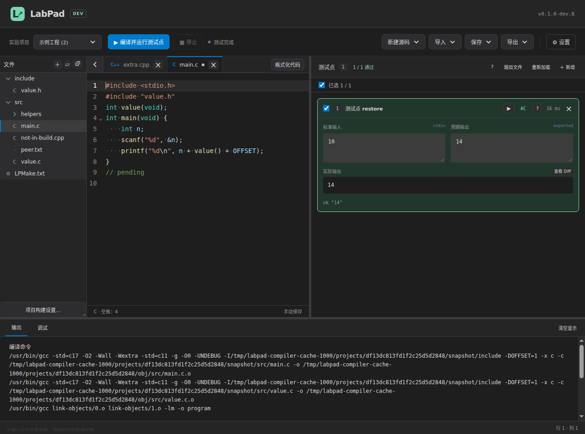
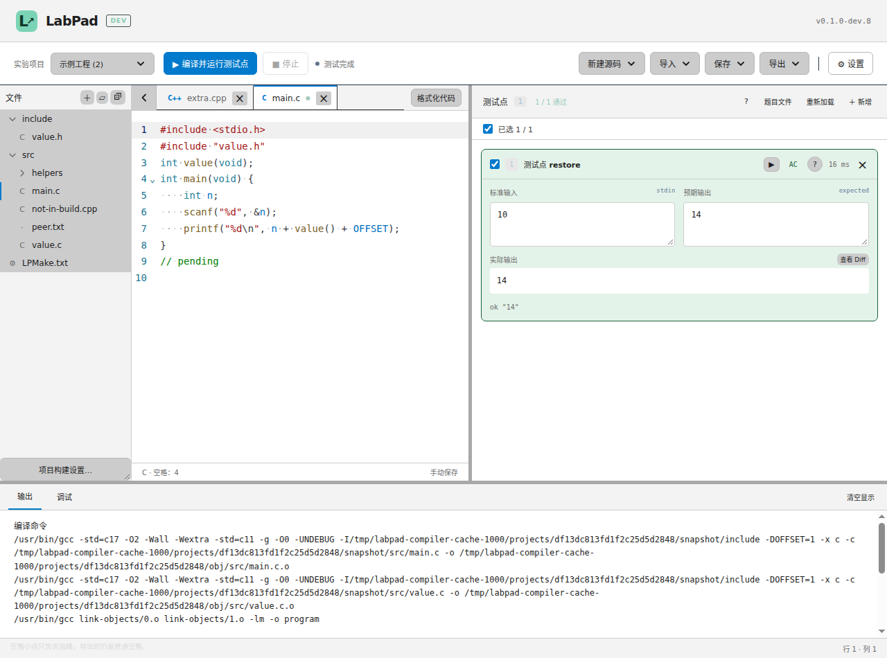

# LabPad 学生指南

适用版本：0.1.0-dev.8（开发预发布）

撰写日期：2026-11-01

## 1. 下载和启动
在 [dev.8 下载页](https://github.com/XePWang/labpad/releases/tag/v0.1.0-dev.8) 选择自己的系统：

| 系统 | 文件名末尾 | 启动方式 |
| --- | --- | --- |
| Windows x64 | win-x64.zip | 完整解压，打开 LabPad.exe |
| Linux x64 | linux-x64.tar.gz | 解压，运行 LabPad |
| Apple 芯片 Mac | mac-arm64.zip | 解压后打开 LabPad.app |

保留包内的 resources、locales 等文件夹。桌面包包含 Zig 编译器和离线格式化器，普通自测不需要另外安装编译器。macOS 构建的实机验证范围见[验证记录](verification.md)。

首次运行先打开“设置”，填写班号、姓名、学号。它们用于导出文件名，不显示在主页。默认手动保存；保存时自动格式化可以关闭。Tab 缩进可选 1、2、4 个空格，主题可选亮色或暗色。

## 2. 导入老师下发的实验
选择“导入 → 导入实验项目”，打开老师下发的 JSON。项目导入后，源码模板和公开测试点已经就位。

LabPad 支持两种实验组织方式：

| 类型 | 怎样编写 | 怎样运行 |
| --- | --- | --- |
| 题集 | 先选题号；同一题可保留多份源码版本 | 编译当前标签中的单个 C/C++ 文件 |
| 多文件项目 | 在左侧文件树中编辑源文件、头文件和 LPMake | 一次构建整个实验项目 |

同名项目导入时，可以建立副本，也可以只更新测试点。更新测试点会保留源码、模板和未保存编辑。确认窗口会列出更新范围；导入文件没有写出的题目和规则保持原值。

## 3. 题集：选题、写代码、自测
1. 从题号下拉中选一道题。
2. 在编辑区完成程序，按 Ctrl+S 保存当前版本。
3. 按 F9 或 Ctrl+Enter 编译并运行。
4. 对照输入、预期输出、实际输出和 Diff 修改程序。
5. 全部通过后继续下一题。

“新建源码”可新建 C 或 C++ 版本。导入源码会复制到本题的数据目录，原始文件保留。同题已有的托管文件再次导入时，会打开已有版本。标签右键可关闭当前、其他、右侧、已保存或全部标签，也可另存为新版本、复制路径。

切换题号时先处理未保存内容，再打开另一题最近编辑的五份源码。更多版本仍保存在数据目录，可通过“导入源码”找回。关闭全部标签后，也可以选择“新建源码”或“最近源码”。

“保存当前”只保存正在编辑的版本；“保存全部”保存编辑区内各版本。格式化、撤销、重做和光标历史以各标签为单位保留。

## 4. 多文件项目：文件树和 LPMake.txt

文件树内点击新建图标，直接输入名称，Enter 创建、Esc 取消。选中文件夹时在其中创建；选中文件时在同级创建，没有树选择时跟随当前编辑文件。点击树中空白处可选择项目根目录。文件夹排在文件前；重命名直接在原位置输入，重复或无效名称在输入框旁提示。

文件标签右键菜单依次提供“复制路径”“复制相对路径”“在文件管理器中显示”，可直接定位实际保存文件。

文件标签前的 SVG 箭头控制文件侧栏：点击展开，再点击收起。侧栏收起后，箭头仍保留在原来的标签栏。

C/C++ 文件打开时，“格式化代码”固定显示在标签栏右侧，鼠标经过文件树或标签不会隐藏按钮。LPMake.txt 与空编辑区不显示该按钮。

文件树中的文件就是这个项目的实际文件，标签表示不同文件。相同路径只打开一个标签；同名文件通过目录区分。此模式不使用题集的多版本管理。

常用操作：

- 点击文件打开；点击文件夹展开或折叠。
- 文件树右键新建、重命名、删除或在文件管理器中显示。
- 顶部“新建源码”可新建 .c / .cpp；文件树“＋”也可创建 .h 等文本文件。
- “新建源码”采用课程对应语言模板；文件树“新建文件”从空白文件开始。
- 在选中的目录下输入文件名，例如 stack.c；输入 helpers/stack.c 可同时建立子目录。
- 关闭标签保留文件。删除文件会再次确认；LPMake 保留在工程中。
- 文件树可一键折叠全部文件夹，F2 重命名、Delete 删除；侧栏可收起、拖动宽度；编辑与测试点、输出区的分隔线也能拖动。

项目根目录的 LPMake.txt 决定哪些文件参与构建，完整语法和示例见 [LPMake 使用手册](lpmake-guide.md)。常见模板只需几行：

~~~text
# src 中新增的 C 文件会自动加入构建
target("app")
set_standard("c11")
add_includedirs("include")
add_files("src/*.c")
~~~

src/*.c 只匹配该目录，src/**/*.c 包括子目录。Glob 已匹配的新文件无需再登记。显式列举的文件重命名时，可勾选同步修改 LPMake 中的对应路径。

“项目构建设置…”与 LPMake 编辑器使用同一份文本。应用表单后，注释保留，改动可以整次撤销；手动保存模式下还需保存。语法错误会标出 LPMake 的行列。LPMake 使用自己的高亮和补全，不执行 C/C++ 格式化。

多文件运行会使用“已保存文件 + 打开标签的未保存内容”，包括头文件和 LPMake。点击运行不会暗中保存全部文件。运行后又修改了内容，需要重新测试。没有打开任何标签时，仍能构建已保存的整个项目。

## 5. 测试点和调试
测试点可以全部、部分或单独运行；失败后可“定位未通过”及“重测未通过”。点击“结果说明”查看缩写含义：

| 结果 | 含义与下一步 |
| --- | --- |
| AC | 本测试点通过，继续检查其他点 |
| WA | 输出不符，查看实际输出和 Diff |
| CE | 编译失败，在“输出”中定位源文件与行号 |
| RE | 运行异常，检查数组边界、指针和退出信息 |
| TLE | 超过时限，检查循环与算法 |
| OLE | 输出过多，检查循环打印 |

题号菜单中的“通过”针对相同源码、规则及编译器；修改后会提示需要重测。单点重测可以逐步补齐覆盖，不能把不同版本的通过结果拼起来。

没有测试点时，编译成功自动进入“调试”。在下方 > 输入行输入内容后按 Enter 发送；需要结束标准输入时使用 EOF。Ctrl+C 可中断程序，选中文本时优先复制。停止按钮也能结束运行。

标准输出需要遵守题目格式。wcmp 忽略 token 之间的空白，但 3.0 与 3.00 不同；严格文本会检查缩进和换行；浮点比较按题目预设容差工作。不要自行给答案添加提示语。

## 6. 恢复和交换测试点
“导入 → 导入标准 I/O”作用于当前题目或当前多文件项目，先选择：

- 覆盖：替换现有测试点，采用文件明确写出的规则。
- 追加：放到现有点之后，保留原点比较规则。重复编号会改成新的唯一编号，并在确认窗口说明。

追加文件有不同的时限或输出上限时，可选择保留当前值或采用导入值；这些限制会影响全部测试点。导入后重新自测。

“导出当前测试点”保存当前配置中的全部测试点；“导出项目测试点”保存整个实验的测试集合。它们不包含学生源码及运行输出。若误删了公开测试点，可重新导入老师的项目 JSON，选择“更新测试点”。

## 7. 导出和提交
先保存需要保留的内容，再选择“导出 → 导出实验项目”。

题集先勾选题号和源码版本。默认全选，取消题号会取消本题全部版本；只取消一个版本仅减少该文件。列表会预览文件名。多文件项目导出整个工程，保留原文件名和相对目录。

“附带 LabPad 项目配置”包括测试点及重建信息：题集默认不勾选，多文件项目默认勾选。多文件项目的 LPMake 始终随源码提供。附带配置的 ZIP 可重新导入 LabPad；只有配置、缺少源码时不能重建工程。

导出前会提示未编辑、未全部通过或身份缺项。身份未填时可点“前往设置”，保存后继续本次导出。确认后通过系统窗口选择位置；在窗口中修改 ZIP 名称，包内外层文件夹也会使用同名。内部源码和 LPMake 保留原名。

~~~text
9527_马冬梅_7355608_实验2.zip
└─ 9527_马冬梅_7355608_实验2/
   ├─ 7355608_Lab 2-1.c
   ├─ 7355608_Lab 2-1_v2.cpp
   └─ 7355608_Lab 2-2.c
~~~

多文件项目的外层名称相同，内部保留 src/、include/ 和 LPMake。将 ZIP 上传到课程指定平台。公开测试通过后，仍需核对指导书中的算法、格式及提交要求。

## 8. 自定义 MinGW/GCC（课程要求时使用）
使用内置 Zig 时可跳过本节。如果老师要求 GCC，可通过 [MSYS2 官方安装说明](https://www.msys2.org/) 安装 MinGW-w64：

1. 安装到默认的 C:\msys64 等英文路径，打开 **MSYS2 UCRT64**。
2. 执行 pacman -S mingw-w64-ucrt-x86_64-gcc，按提示完成安装。
3. 在 LabPad“设置 → 编译器”选择“自定义编译器”，点击“自动检测”。
4. 选择检测到的 GCC，核对 C/C++ 路径，保存设置。

默认路径通常为 C:\msys64\ucrt64\bin\gcc.exe 和 C:\msys64\ucrt64\bin\g++.exe。也可浏览文件或直接输入完整路径；路径不存在时界面会提示。工具链安装目录使用英文路径，可避免部分 MinGW 发行版的资源定位问题。MSYS2 对 UCRT64 的说明见[官方环境文档](https://www.msys2.org/docs/environments/)。

本机默认参数与当前实验参数分开设置。题集可覆盖本机默认参数；多文件项目的标准、宏和编译参数写在 LPMake 中。

## 9. 常用快捷键
| 操作 | Windows / Linux | macOS 默认 |
| --- | --- | --- |
| 保存当前 | Ctrl+S | Cmd+S |
| 保存全部 | Ctrl+Shift+S | Cmd+Option+S |
| 编译运行 | F9 / Ctrl+Enter | F9 / Control+Enter |
| 格式化 C/C++ | Shift+Alt+F | Shift+Option+F |
| 查找 | Ctrl+F | Cmd+F |
| 替换 | Ctrl+H | Cmd+Option+F |
| 撤销 / 重做 | Ctrl+Z / Ctrl+Shift+Z | Cmd+Z / Cmd+Shift+Z |
| 缩进 / 减少缩进 | Tab / Shift+Tab | Tab / Shift+Tab |
| 恢复 100% 缩放 | Ctrl+0 | Cmd+0 |

“设置 → 快捷键”按当前系统显示实际组合键：Windows/Linux 使用 Ctrl、Alt，Mac 使用 ⌘、⌥、⇧、⌃。可录制或直接填写，主界面提示跟随当前设置。Mac 系统的隐藏、最小化和退出键保持系统行为。

## 10. 常见问题
**刚启动或清理缓存后，编译较慢。** Zig 会在后台预热，但项目标准、优化设置及标准库不同仍可能需要首次编译；第二次通常更快。清理缓存会重新经历这一步。

**源文件写了，却没有参与构建。** 检查 LPMake 的 add_files、remove_files、目录和后缀，确认没有被排除。

**一个项目出现两个 main。** 多文件模式会把匹配到的源文件一起链接；每个可执行目标只保留一个 main。题集则每个版本单独编译。

**保存以后原始导入文件没有变化。** LabPad 修改的是数据目录中的副本。需要提交时使用“导出”。

**缩放后找不到按钮。** 按 Ctrl+0 / Cmd+0 恢复 100%。

**数据在哪里？** 默认在程序旁的 labpad 文件夹；“设置 → 数据位置”可查看、打开或迁移。不要把源码和实验数据当成编译缓存删除。
