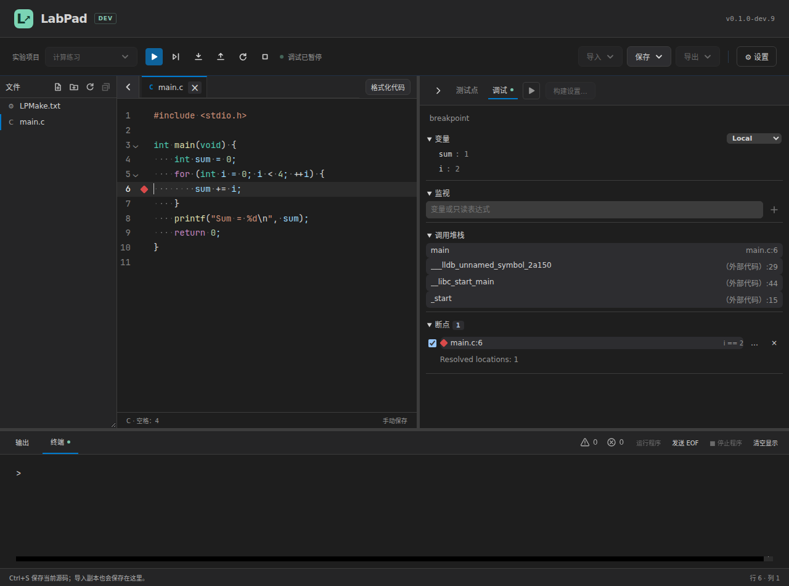
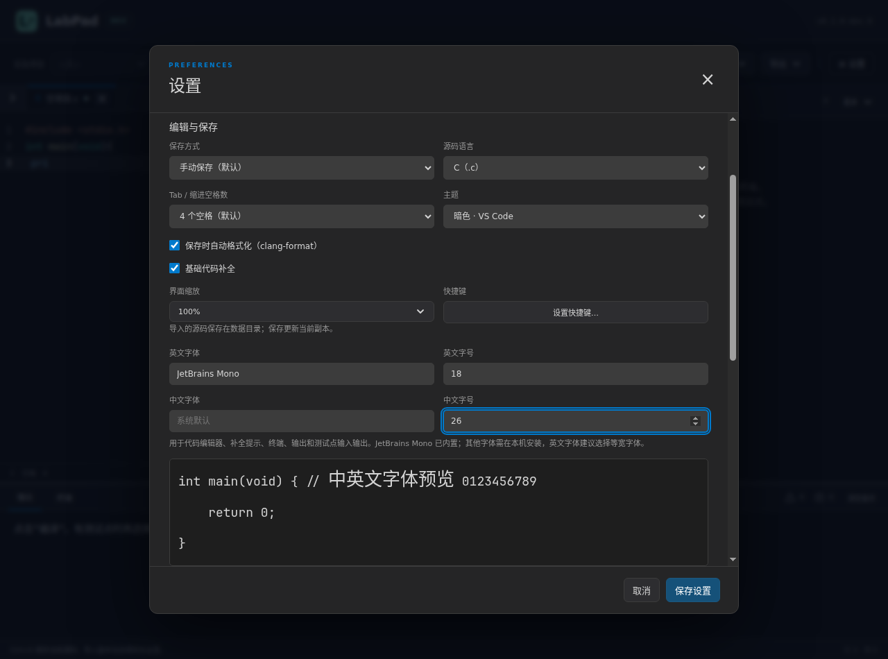

# LabPad 学生指南

适用版本：0.1.0-dev.9（开发预发布）

撰写日期：2026-11-01

更新日期：2026-11-08

## 1. 下载和启动
在 [dev.9 下载页](https://github.com/XePWang/labpad/releases/tag/v0.1.0-dev.9) 选择自己的系统：

| 系统 | 文件名末尾 | 启动方式 |
| --- | --- | --- |
| Windows x64 | win-x64.zip | 完整解压，打开 LabPad.exe |
| Linux x64 | linux-x64.tar.gz | 解压，运行 LabPad |
| Apple 芯片 Mac | mac-arm64.zip | 解压后打开 LabPad.app |

保留包内的 resources、locales 等文件夹。桌面包包含 Zig 编译器和离线格式化器，普通自测不需要另外安装编译器。macOS 构建的实机验证范围见[验证记录](verification.md)。

首次运行先打开“设置”，填写班号、姓名、学号。它们用于导出文件名，不显示在主页。默认手动保存；保存时自动格式化可以关闭。Tab 缩进可选 1、2、4 个空格，主题可选亮色或暗色。

## 2. 导入老师下发的实验
选择“导入 → 导入实验项目”，打开老师下发的 JSON。项目导入后，源码模板和公开测试点已经就位。

LabPad 支持两种实验组织方式：

| 类型 | 怎样编写 | 怎样运行 |
| --- | --- | --- |
| 题集 | 先选题号；同一题可保留多份源码版本 | 编译当前选中的 C/C++ 源码版本 |
| 多文件项目 | 在左侧文件树中编辑源文件、头文件和 LPMake | 一次构建整个实验项目 |

同名项目导入时，可以建立副本，也可以只更新测试点。更新测试点会保留源码、模板和未保存编辑。确认窗口会列出更新范围；导入文件没有写出的题目和规则保持原值。

## 3. 题集：选题、写代码、自测
1. 从题号下拉中选一道题。
2. 在编辑区完成程序，按 Ctrl+S 保存当前版本。
3. 按 F9 或 Ctrl+Enter，或点击顶部“编译”。未保存时，选择“保存并编译”或取消。“保存并编译”会先保存打开文件的修改；也可先使用“保存当前 / 保存全部”再编译。
4. 编译成功后点击蓝色“运行全部测试点”，对照实际输出和 Diff 修改程序。
5. 修改源码后重新保存、编译；全部通过后继续下一题。

“新建源码”可新建 C 或 C++ 版本。导入源码会复制到本题的数据目录，原始文件保留。同题已有的托管文件再次导入时，会打开已有版本。标签右键可关闭当前、其他、右侧、已保存或全部标签，也可另存为新版本、复制路径。

切换题号时先处理未保存内容，再打开另一题最近编辑的五份源码。更多版本仍保存在数据目录，可通过“导入源码”找回。关闭全部标签后，也可以选择“新建源码”或“最近源码”。

“保存当前”只保存正在编辑的版本；“保存全部”保存编辑区内各版本。格式化、撤销、重做和光标历史以各标签为单位保留。

查看头文件、题目 JSON 或其他文本时，题集仍以此前选中的源码版本为编译目标。点击另一份 C/C++ 源码标签才会切换目标；删除目标源码后，请重新选择要编译的源码。一次保存失败不会阻止后续重试。

新配置的 C / C++ 默认采用 C17 / C++20。已有编译参数和课程项目中明确指定的标准继续优先。

## 4. 多文件项目：文件树和 LPMake.txt

文件树内点击新建图标，直接输入名称，Enter 创建、Esc 取消。选中文件夹时在其中创建；选中文件时在同级创建，没有树选择时跟随当前编辑文件。点击树中空白处可选择项目根目录。文件夹排在文件前；重命名直接在原位置输入，重复或无效名称在输入框旁提示。

文件标签右键菜单依次提供“复制路径”“复制相对路径”“在文件管理器中显示”，可直接定位实际保存文件。

文件标签前的 SVG 箭头控制文件侧栏：点击展开，再点击收起。侧栏收起后，箭头仍保留在原来的标签栏。两侧收起再展开均保留宽度和当前分组；系统开启“减少动画”时同步减少过渡。

C/C++ 文件打开时，“格式化代码”固定显示在标签栏右侧，鼠标经过文件树或标签不会隐藏按钮。LPMake.txt 与空编辑区不显示该按钮。

文件树中的文件就是这个项目的实际文件，标签表示不同文件。相同路径只打开一个标签；同名文件通过目录区分。此模式不使用题集的多版本管理。

常用操作：

- 点击文件打开；点击文件夹展开或折叠。
- 文件树右键新建、重命名、删除或在文件管理器中显示。
- 项目通过文件树“＋”新建 .c、.cpp、.h 等文件；顶部“新建源码”只在题集显示。
- 题集“新建源码”采用课程对应语言模板；文件树“新建文件”从空白文件开始。
- 在选中的目录下输入文件名，例如 stack.c；输入 helpers/stack.c 可同时建立子目录。
- 关闭标签保留文件。删除文件会再次确认；LPMake 保留在工程中。
- 文件树可一键折叠全部文件夹，F2 重命名、Delete 删除；侧栏可收起、拖动宽度；编辑与测试点、输出区的分隔线也能拖动。

项目根目录的 LPMake.txt 决定哪些文件参与构建，完整语法和示例见 [LPMake 使用手册](lpmake-guide.md)。新建项目默认把 main.c / main.cpp 放在根目录。构建模板使用固定的 C17 / C++20、Debug 和常用警告，例如：

~~~text
target("app")
set_standard("c17")
set_standard("c++20")
set_mode("debug")
add_includedirs("./")
add_files("./*.c", "./*.cpp")
add_cflags("-Wall", "-Wextra", "-Wshadow", "-Wconversion", "-Wundef", "-Wformat=2")
add_cxxflags("-Wall", "-Wextra", "-Wshadow", "-Wconversion", "-Wundef", "-Wformat=2")
add_links("m")
~~~

./ 和 . 都表示项目根目录。./*.c 只匹配根目录，./**.c 与 ./**/*.c 都包括子目录。Glob 已匹配的新文件无需再登记。显式列举的文件重命名时，可勾选同步修改 LPMake 中的对应路径。

展开实验选择框，在底部点击“构建设置…”；右键选择框或列表中的实验也能进入。

表单与 LPMake 编辑器使用同一份文本，打开表单会激活 LPMake 标签。点击“应用”只修改编辑缓冲；保存该标签或保存全部才写入文件。撤销、放弃与普通文本文件一致。全局编译参数不参与项目构建。

导入项目缺少 LPMake 时，会提示“原项目未提供 LPMake.txt，已填充默认模板”。选择“修改配置”核对源码模式；选择“忽略”继续编辑。模板只匹配根目录，不会猜测其他目录；若原文件在 src 中，应按实际布局修改 add_files。

语法及构建配置错误会标出 LPMake 的行列、原文和提示。LPMake 使用自己的高亮与补全，不执行 C/C++ 格式化。

项目编译读取全部已保存文件，包括头文件和 LPMake。编译前若有未保存文件，会明确询问是否保存并编译。只保存当前普通源码，也不会顺带保存尚未保存的构建配置。源码或构建配置变化后，需要重新保存、编译再测试。没有打开任何标签时，仍能构建已保存的整个项目。

## 5. 测试点和终端
编译成功后，测试点栏的“运行全部测试点”变为蓝色。可运行全部、已选点或单点；失败后可“定位未通过”及“重测未通过”，这些操作沿用当前已编译程序。灰色按钮表示尚未成功编译，或源码/构建配置已变化，需要重新编译。只改输入、预期输出或比较规则时，可以直接重测。点击“结果说明”查看缩写含义：

| 结果 | 含义与下一步 |
| --- | --- |
| AC | 本测试点通过，继续检查其他点 |
| WA | 输出不符，查看实际输出和 Diff |
| CE | 编译失败，在“输出”中定位源文件与行号 |
| RE | 运行异常，检查数组边界、指针和退出信息 |
| TLE | 超过时限，检查循环与算法 |
| OLE | 输出过多，检查循环打印 |

题号菜单中的“通过”针对相同源码、规则及编译器；修改后会提示需要重测。单点重测可以逐步补齐覆盖，不能把不同版本的通过结果拼起来。

没有测试点时，编译成功自动进入“终端”。直接在终端的 > 提示符后输入数据，按 Enter 发送；光标与输入就在输出内容中，没有单独的输入框。上、下箭头找回本次会话的输入，左右箭头移动光标，Backspace / Delete 删除字符，Home / End 到行首、行尾。程序输出新内容时，正在输入的文字和光标位置会保留。

Ctrl+C 有选区时复制，没有选区时中断程序；Mac 也可用 Command+C 复制。需要结束标准输入时点击“发送 EOF”，空输入下可按 Ctrl+D；Windows 还支持 Ctrl+Z。停止按钮也能结束运行。

历史只属于本次程序运行会话，不写入磁盘。默认最多保留 65536 个 UTF-8 字节，超过时删除最旧的完整输入；可在“设置 → 终端”修改上限。重新编译会清空历史。

“输出”右侧的三角图标表示警告，圆圈图标表示错误，旁边数字在每次编译后刷新。原始诊断仍完整保留在“输出”中。

标准输出需要遵守题目格式。wcmp 忽略 token 之间的空白，但 3.0 与 3.00 不同；严格文本会检查缩进和换行；浮点比较按题目预设容差工作。不要自行给答案添加提示语。

## 6. 恢复和交换测试点
“导入 → 导入测试点”作用于当前题目或当前多文件项目，先选择：

- 覆盖：替换现有测试点，采用文件明确写出的规则。
- 追加：放到现有点之后，保留原点比较规则。重复编号会改成新的唯一编号，并在确认窗口说明。

追加文件有不同的时限或输出上限时，可选择保留当前值或采用导入值；这些限制会影响全部测试点。导入后重新自测。

“导出当前测试点”保存当前配置中的全部测试点；“导出项目测试点”保存整个实验的测试集合。它们不包含学生源码及运行输出。若误删了公开测试点，可重新导入老师的项目 JSON，选择“更新测试点”。

## 7. 导出和提交
先保存需要保留的内容，再选择“导出 → 导出实验项目”。

题集先勾选题号和源码版本。默认全选，取消题号会取消本题全部版本；只取消一个版本仅减少该文件。列表会预览文件名。多文件项目导出整个工程，保留原文件名和相对目录。

“附带 LabPad 项目配置”包括测试点及重建信息：题集默认不勾选，多文件项目默认勾选。多文件项目的 LPMake 始终随源码提供。附带配置的 ZIP 可重新导入 LabPad；只有配置、缺少源码时不能重建工程。

导出前会提示未编辑、未全部通过或身份缺项。身份未填时可点“前往设置”，保存后继续本次导出。确认后通过系统窗口选择位置；在窗口中修改 ZIP 名称，包内外层文件夹也会使用同名。内部源码和 LPMake 保留原名。

~~~text
9527_马冬梅_7355608_实验2.zip
└─ 9527_马冬梅_7355608_实验2/
   ├─ 7355608_Lab 2-1.c
   ├─ 7355608_Lab 2-1_v2.cpp
   └─ 7355608_Lab 2-2.c
~~~

多文件项目的外层名称相同，内部保留实际目录、源码和 LPMake。将 ZIP 上传到课程指定平台。公开测试通过后，仍需核对指导书中的算法、格式及提交要求。

## 8. 自定义 MinGW/GCC（课程要求时使用）
使用内置 Zig 时可跳过本节。如果老师要求 GCC，可通过 [MSYS2 官方安装说明](https://www.msys2.org/) 安装 MinGW-w64：

1. 安装到默认的 C:\msys64 等英文路径，打开 **MSYS2 UCRT64**。
2. 执行 pacman -S mingw-w64-ucrt-x86_64-gcc，按提示完成安装。
3. 在 LabPad“设置 → 编译器”选择“自定义编译器”，点击“自动检测”。
4. 选择检测到的 GCC，核对 C/C++ 路径，保存设置。

默认路径通常为 C:\msys64\ucrt64\bin\gcc.exe 和 C:\msys64\ucrt64\bin\g++.exe。也可浏览文件或直接输入完整路径；路径不存在时界面会提示。工具链安装目录使用英文路径，可避免部分 MinGW 发行版的资源定位问题。MSYS2 对 UCRT64 的说明见[官方环境文档](https://www.msys2.org/docs/environments/)。

### 编译器与参数来源

“设置 → 编译器”选择本机工具链和路径；“高级编译参数”选择实际使用哪组参数：

| 当前内容 | 参数来源 |
| --- | --- |
| 未分配实验的源码 | 全局配置 |
| 题集 | 全局配置，或当前实验项目 |
| 项目 | LPMake.txt，来源锁定为当前项目 |

题集导入了预设参数时，首次自动选中“当前实验项目 · 名称”。选择“全局配置”并保存后，本实验改用全局参数，原实验参数仍保留；切回并保存即可恢复。两组修改各自暂存，“保存设置”一起保存，“取消”则不改动。每行填写一个参数。

项目显示“由 LPMake.txt 指定”，通过“编辑构建设置”修改同一个文件。项目不使用全局参数。展开实验菜单的“构建设置…”也能直接进入，题集会定位到参数来源，项目会打开 LPMake 表单。

“查看生效参数”列出标准、模式、目录、宏和原始参数。额外参数后置，可能覆盖前面的标准或优化；覆盖和链接配对提示供核对，不会自动替你复制参数。

自动检测后，“同时使用推荐参数”默认勾选；取消则只更新编译器类型和路径。保存后生效，不改写 LPMake 或题集自定义参数。

### 看懂编译警告

新配置默认开启六项警告。程序出现警告仍可编译运行；先看提示中的文件与行号，再检查相应语句：

| 提示来源 | 常见原因与处理 |
| --- | --- |
| -Wall / -Wextra | 未使用变量、可疑表达式或参数；确认语句是否写完整 |
| -Wshadow | 内层变量与外层同名；换一个能说明用途的名称 |
| -Wconversion | 小数转整数或范围缩小；核对类型、范围和是否确实需要截断 |
| -Wundef | #if 使用了未定义的宏；检查拼写，或用 #ifdef 判断是否定义 |
| -Wformat=2 | printf / scanf 格式与参数不匹配，或格式串不固定；核对格式，例如 printf("%s", text) |

警告是排查线索，不代表所有提示都要强行加类型转换消除。-Wpedantic 可按课程要求另行启用；默认没有把警告当成错误。

## 9. 常用快捷键
| 操作 | Windows / Linux | macOS 默认 |
| --- | --- | --- |
| 保存当前 | Ctrl+S | Cmd+S |
| 保存全部 | Ctrl+Shift+S | Cmd+Option+S |
| 编译 | F9 / Ctrl+Enter | F9 / Control+Enter |
| 格式化 C/C++ | Shift+Alt+F | Shift+Option+F |
| 查找 | Ctrl+F | Cmd+F |
| 替换 | Ctrl+H | Cmd+Option+F |
| 撤销 / 重做 | Ctrl+Z / Ctrl+Shift+Z | Cmd+Z / Cmd+Shift+Z |
| 缩进 / 减少缩进 | Tab / Shift+Tab | Tab / Shift+Tab |
| 恢复 100% 缩放 | Ctrl+0 | Cmd+0 |

“设置 → 快捷键”按当前系统显示实际组合键：Windows/Linux 使用 Ctrl、Alt，Mac 使用 ⌘、⌥、⇧、⌃。可录制或直接填写，主界面提示跟随当前设置。Mac 系统的隐藏、最小化和退出键保持系统行为。

终端内的编辑键：

| 操作 | Windows / Linux | Mac |
| --- | --- | --- |
| 行首 / 行尾 | Home / End，Ctrl+A / Ctrl+E | Ctrl+A / Ctrl+E，Cmd+← / Cmd+→ |
| 前后移动一个词 | Ctrl+← / Ctrl+→ | Option+← / Option+→ |
| 删除前一个词 | Ctrl+Backspace | Option+Delete（退格键） |
| 删除到行尾 / 清空输入 | Ctrl+K / Ctrl+U | Ctrl+K / Ctrl+U |
| 清空显示并保留输入 | Ctrl+L | Ctrl+L |
| 插入 Tab / 换行编辑 | Tab / Shift+Enter | Tab / Shift+Enter |
| 历史上一条 / 下一条 | ↑ / ↓ | ↑ / ↓ |
| 复制选区 | Ctrl+C | Cmd+C 或 Ctrl+C |
| 中断程序 | 无选区时 Ctrl+C | 无选区时 Ctrl+C |

Mac 的行编辑与系统保留键参考 [Apple 终端快捷键](https://support.apple.com/guide/terminal/keyboard-shortcuts-trmlshtcts/mac)；本版 Mac 原生运行状态见[验证记录](verification.md)。

## 10. 常见问题
**刚启动或清理缓存后，编译较慢。** Zig 会在后台预热，但项目标准、优化设置及标准库不同仍可能需要首次编译；第二次通常更快。清理缓存会重新经历这一步。

**切到全局配置后，原实验参数去哪了？** 它们仍保留在“当前实验项目”中，切回并保存即可使用。项目模式始终由 LPMake 指定。

**表单选择 C17，为什么实际用了 C11？** 展开“查看生效参数”，检查额外 C 参数是否又写了 -std=c11。后面的标准选项可以覆盖前面的选择。

**运行测试点为什么是灰色？** 先保存源码与构建配置，再点顶部“编译”。编译通过后才可送测；错误原因在“输出”中。

**源文件写了，却没有参与构建。** 检查 LPMake 的 add_files、remove_files、目录和后缀，确认没有被排除。

**一个项目出现两个 main。** 多文件模式会把匹配到的源文件一起链接；每个可执行目标只保留一个 main。题集则每个版本单独编译。

**保存以后原始导入文件没有变化。** LabPad 修改的是数据目录中的副本。需要提交时使用“导出”。

**缩放后找不到按钮。** 按 Ctrl+0 / Cmd+0 恢复 100%。

**数据在哪里？** 默认在程序旁的 labpad 文件夹；“设置 → 数据位置”可查看、打开或迁移。不要把源码和实验数据当成编译缓存删除。

## 11. 文件操作与基础补全

题集也可以展开文件区。题集仍只编译当前源码，同目录其他 C/C++ 文件不会自动链接；头文件可在当前源码中通过 include 使用。项目按照 LPMake.txt 的源文件范围构建。

文件区支持刷新、新建文件和文件夹、F2 重命名、复制、剪切、粘贴及删除。Ctrl（Mac 为 Command）点击多选，Shift 点击连续选择，也可从空白处拖出选框。拖动文件可移动到文件夹，Windows/Linux 按 Ctrl、Mac 按 Option 拖动表示复制。从系统文件管理器拖入时导入副本。删除和替换同名文件会要求确认。

基础补全提供关键词、当前可见声明、已包含头文件中的声明，以及常用标准库函数名和签名。if、for、while、switch 等模板需要自己填写条件和正文。

- Tab 接受当前候选；尚未选择时接受第一项。
- 上下键选中后，Enter 接受；未用上下键选中时，Enter 正常换行。
- Esc 关闭候选；Alt+/ 手动唤起。Ctrl+Space 也可唤起，可能与系统输入法快捷键重叠。
- 模板内 Tab / Shift+Tab 在占位符之间移动；没有候选和占位符时沿用缩进。
- “设置 → 编辑与保存 → 基础代码补全”可关闭该功能。

补全只给名称、签名和简短语句骨架，不生成算法。

## 12. 终端命令

底部“终端”空闲时显示相对目录和 >。输入 help 查看命令。支持 pwd、ls、ll、cd、mkdir、touch、cat、cp、mv、rm、clear；路径有空格时加引号。例如：

~~~text
mkdir "练习代码"
ls
cd "练习代码"
pwd
cd ..
~~~

内置文件命令限制在当前实验中，删除与覆盖沿用文件区确认。这里不执行管道、重定向和系统脚本。运行的 C/C++ 程序仍使用当前用户的本机权限。

多文件配置可使用 lpmake build / run / clean，简写 b / r / c。**只查当前目录的 LPMake.txt**，不会向上查找。build 将产物保存在该目录的 build/；run 要求这份配置已构建且输入没有变化；clean 仅清理该配置管理的产物，保留普通用户文件。题集没有配置时会提示“当前目录未找到 LPMake.txt”。

GUI 的“编译”、测试点和断点调试继续使用临时目录及受控缓存，不在实验中生成 build/。两种入口不能借用彼此或其他配置的旧程序。

程序运行时，终端输入送给程序，ls、rm 等文字不会当作命令执行。程序退出后恢复命令提示符。Ctrl+C 有选区时复制；没有选区时停止普通程序，断点调试中请求暂停。Mac 的 Command+C 只复制。

## 13. 项目断点调试

右区“调试”仅在项目中显示。题集可以用终端检查输入输出。项目默认内置离线调试器，不需要下载组件。

1. 保存源码、头文件和 LPMake.txt，在右区切到“调试”。
2. 点击行号左侧设置断点；右键可填写条件，例如 i == 2。
3. 点击右区标题栏的蓝色三角形“开始调试”，或按 F5。暂停后查看变量、监视和调用堆栈。
4. 使用继续 / 暂停、单步跳过、单步进入、单步跳出、重启、停止。图标悬停显示名称。
5. 输入输出仍在下方“终端”；点击调用堆栈可定位项目中的源码。

条件成立时才暂停；断点列表可启用、禁用、修改条件或移除。实心断点表示已验证，空心表示待验证，条件断点使用独立形状和提示。监视适用于变量、字段、数组下标等只读表达式。

调试时可以改代码。界面会提示“源码已修改，与当前调试进程不一致；点击「重启」重新编译并调试”。保存不会更新旧进程；撤销回原内容可以消除提示。重启前有未保存修改时，选择“保存并重启”或取消。取消或保存失败保留当前会话。调试参与文件及其父目录在会话中不能移动、重命名或删除。

建议使用项目 Debug 模式；关闭调试信息或强优化会影响断点位置和变量显示。调试快捷键为 F5、F10、F11、Shift+F11、Ctrl/Command+Shift+F5、Shift+F5；F9 仍是编译，可在快捷键设置中修改。

测试点和调试共用右区，可收起。测试点行显示 X/Y 已选，运行时显示 X/Y 已完成，结束后显示 X/Y 通过；主运行图标按勾选范围执行，悬停说明实际范围。选中摘要平时透明，全部通过后显示与 AC 测试框相同的绿色底框；运行按钮采用蓝底与白色实心三角形。点击复选框可调整全选状态。

自测使用课程公开测试点；助教评测还会用隐藏测试点检查其他输入和边界值。

## 字体与字号

在“设置 → 编辑与保存”分别设置英文字体、英文字号、中文字体、中文字号，点击“保存设置”后应用到代码编辑器、补全提示和终端。字号范围为 8–40，默认均为 14。

英文默认使用随包的 JetBrains Mono，无需安装或联网。中文默认使用本机字体；也可从建议列表选择，或填写已安装的字体名称。其他英文字体同样需要本机已安装，建议使用等宽字体。无效名称会在预览下方提示，修正后才能保存；取消设置会保留原来的字体。

预览同时显示中英文和数字。两种字号不同时，终端仍按固定网格排列，自动调整行高与字符间距。

