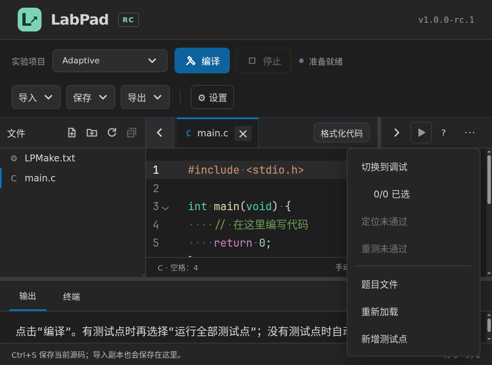

# LabPad RC.1 最终源码审查

审查日期：2026-11-09。基线：8a7861f。范围为当前题集、项目及其学生自测、导出收件、助教批测业务；不新增构建后端或补全语义能力。

## 结论与证据范围

本轮确认七项源码问题和标题栏排布问题，按文件事务、输入读取/报告清理、重复读取、界面四组处理。单项结论来自下列真实实现及隔离故障探针；测试与平台汇总见 [验证记录](verification.md)。macOS 没有实机。

## R1 · 文件移动双重失败会删除唯一源码 · P1

- 基线位置：`pad/core/files.ts:267`。修复位置：`pad/core/files.ts:269`。
- 触发：将 main.c 移至 nested/main.c；来源已经进入事务目录，目标 rename 报 EPERM，随后恢复原位也报 EPERM。
- 原因：恢复操作尚未加入 undo；恢复抛错后外层仍删除事务目录。基线探针验证原位与备份均不存在。
- 修复：首次移动后立即登记恢复，跟踪源码当前所在位置；恢复失败保留备份，并在提示中指出目录。
- 复现/回归：`npx tsx --test tests/rc1-file-rollback.test.ts`；同时跑 files 与 file-reconciliation 回归。真实文件字节参与断言。

## R2 · 目录快照只相信早先的文件大小 · P2

- 基线位置：`pad/core/workspace-files.ts:101`。修复位置：`pad/core/workspace-files.ts:100`。
- 触发：文件在 lstat 与 readFile 之间增长；单文件或总量统计仍使用旧 size。
- 证据：夹具将路径元数据固定为旧值，实际文件为 8,388,609 字节。基线读取并接受，修复后拒绝。已有读取底座另测打开后继续增长、哨兵字节与句柄关闭。
- 修复：复用有界读取，按实际字节累计项目预算，不再全量 readFile。
- 复现/回归：`tests/rc1-boundaries.test.ts` 第一项及 `tests/read-file.test.ts`。

## R3 · CLI 单次送测与历史源码读入遗漏限制 · P2

- 基线位置：`pad/cli/main.ts:47`、`pad/cli/main.ts:56`、`pad/cli/versions.ts:64`。
- 修复位置：`pad/cli/main.ts:87`、`pad/cli/versions.ts:64`。
- 触发：`labpad judge --source large.c --tests tests.json` 或 `--project large.zip`；文件大小超过入口预算。
- 证据：对上一轮真实 CLI 归档分别传入 8 MB+1 的源码与 100 MB+1 的 ZIP，在 readFile 即将分配前拦截，两个入口都到达未限量读取。没有在日常进程中制造内存耗尽。
- 修复：单次入口调用同一有界读取底座；历史单文件版本恢复沿用批量收件的 2 MB 限制，失败仍进入待核对。
- 回归：`tests/rc1-boundaries.test.ts` 第二项。GUI、CLI 收件、单次送测和历史读取路径均静态对照。

## R4 · 批测清理失败盖住原错误并跳过解锁 · P2

- 基线位置：`pad/cli/grade.ts`；单次送测也有相同清理出口。
- 修复位置：`pad/cli/grade.ts:725`、`pad/cli/main.ts:165`。
- 触发：编译器诊断失败后，dispose 再报 EBUSY。原实现返回清理错误，release 未执行。
- 证据：隔离运行同一批测入口，注入 dispose 失败，核对原错误文本及 proper-lockfile 的真实锁状态；修复后原诊断保留并附清理信息，锁可再次取得。
- 修复：会话、锁、自检目录独立清理。成功报告不因备份删除失败被报告为评测失败。
- 回归：`tests/rc1-boundaries.test.ts` 第三项，完整批测和补交回归。

## R5 · 报告发布回滚会丢掉原始诊断和新报告 · P2

- 基线位置：`pad/cli/grade.ts`。修复位置：`pad/cli/grade.ts:346`。
- 触发：output 已移入旧备份，暂存目录发布失败，再恢复旧 output 也失败。
- 证据：基线函数注入发布 ENOSPC、恢复 EBUSY 后只返回 EBUSY，新暂存报告被删除，旧备份仍在。另一个用例验证提交成功后仅备份清理失败。
- 修复：等待所有暂存写入完成；双失败时保留两份报告并给出位置，原 ENOSPC 继续是主错误。已提交报告的清理问题仅返回提醒。
- 回归：`npx tsx --test tests/rc1-report-output.test.ts`，同时核对原评语保留。

## R6 · 补全与编译状态进行多余的整项目读取 · P2

- 位置：`pad/electron/main.ts:1319`、`pad/electron/main.ts:2253`。
- 触发：项目内含 8 MB 运行数据，打开编辑器或刷新编译状态。
- 证据：用 AsyncLocalStorage 按真实 IPC 请求统计打开次数；基线补全读取无关数据一次，编译状态读取两次；修复后为 0 次和 1 次。
- 修复：快照支持按文件筛选；补全只读头文件与项目根 LPMake，题集不读取 LPMake 参数。编译状态复用已保存输入。构建/评测的完整资源快照保持不变。
- 回归：`tests/ui/rc1-read-pipeline.spec.ts`。终端 cat 夹具改为按 terminal:command 归属计数，原 0 字节拒绝、1 MB+1 哨兵及句柄关闭断言均保留。

## R7 · 大比例缩放时分区高度被挤成个位数 · P2

- 位置：`pad/src/themes.css` 的 work-layout / splitpanes 最小高度与 app-shell 滚动规则。
- 触发：1280 像素窗口使用 400% 缩放。原工作区只剩 16.5 CSS px，上部编辑与测试点区域只剩 8.28 px；40 px 标题栏被父级裁剪，控件无法命中。
- 修复：为工作区和上下两部分设置基本内容高度，空间不足时由应用纵向滚动承接；不让固定高度标题栏挤压成不可点击区域。
- 回归：`tests/ui/rc1-toolbar.spec.ts`，原生窗口内用元素命中测试及实际浮层边界检查，保留失败截图与几何记录。

## U1 · 标题栏高度与窄分区操作

- 原测量：文件区 36、编辑标签 37、测试/调试 48、输出/终端 38 CSS px。
- 位置：`pad/src/style.css:2`、`pad/src/App.vue:535`、`pad/src/components/ActionMenu.vue:5`。
- 修复：统一 40 CSS px；右区保留收起和运行入口，次级操作随空间进入“更多”，恢复宽度后再显示。浮层挂载到窗口层，按窗口边界避让、限高和滚动。
- 复用 [Reka DropdownMenu](https://reka-ui.com/docs/components/dropdown-menu) 的 Portal、焦点管理、碰撞避让及 available-height 变量；不自建菜单定位或键盘循环。
- 回归：`tests/ui/rc1-interface.spec.ts`、`tests/ui/rc1-toolbar.spec.ts`，含窄分区、缩放、菜单超出分区范围、短窗口键盘访问。

## 主题黑底观察

Linux 与 Windows 均操作真实设置页面，连续四轮切换、两个缓存标签、32 个渲染帧核对，未见编辑器与界面主题底色不一致。另发现 `tests/ui/interface-state.spec.ts` 直接修改壳层 data-theme、未同步编辑器 props，可制造壳层与编辑器配色不一致；已改为实际设置操作。这个夹具缺陷不能解释用户观察到的每一次闪烁，正常路径的本轮逐帧检查没有复现。

## 巡检覆盖与保留的实现

| 业务链路 | 源码与检查重点 |
| --- | --- |
| 保存、切题与版本 | App 保存队列、Storage/Workspace 事务、显式构建目标、头文件/文本辅助标签；检查失败不毒化队列、旧响应不跨视图 |
| 文件事务 | FileService、路径同步、断点和终端目录映射、调试期间结构操作限制；对照失败回滚与唯一备份 |
| 构建与进程 | 单文件 Compiler、多文件 Build、CompiledProgram、Cache、Process、PTY；检查取消、租约、当前产物、原错误与清理独立性 |
| 调试 | DAP 连接/会话、栈帧、变量、监视、源码变更、停止与重启；保留检查代次和过时响应拒绝 |
| 补全与编辑 | CodeMirror 原生语法树和补全、声明/作用域/头文件缓存、Tab/Enter、格式化、字体和缓存 EditorState |
| 导入、比较与导出 | v1/v2 协议、测试点补丁、覆盖/追加、wcmp/float/strict、导出选题/版本/配置、路径及二进制数据 |
| CLI 与成绩 | 目录/ZIP 收件、完整版本保留、最高分选择、名单顺序、公开/隐藏测试、百分制闭合、CSV 评语及输出替换 |
| 界面与生命周期 | 亮暗主题、浮层、焦点、侧栏、缩放、字体范围、窗口与程序退出 |

现有 CodeMirror、diff、Reka、write-file-atomic、文件操作、PTY 与清理底座继续复用；本轮未增加第二套构建/补全/文件管理框架。完整函数路径巡检不代表所有外部 I/O 组合都可穷举；上述七项均有具体触发及可重复证据。

## 验证材料

隔离探针及两端原生日志在工作目录 rc1-final-audit 保存；可提交的回归位于 pad/tests。基线失败、修复后成功分开记录。报告不将模拟故障当作已定位的 OS 占用原因。

