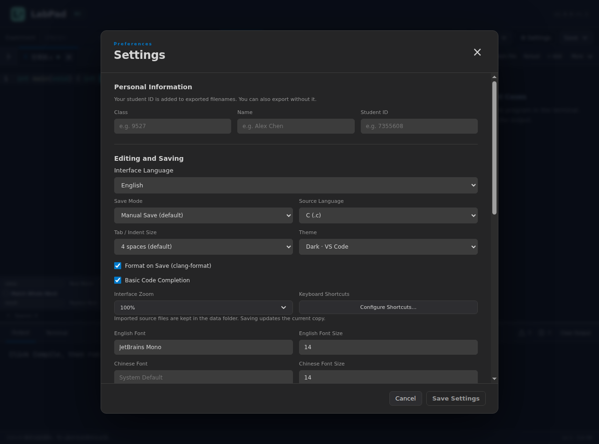

# LabPad 界面语言维护说明

适用版本：1.0.0-rc.1。撰写及核验日期：2026-11-09。

## 使用

“设置 → 编辑与保存 → 界面语言”提供简体中文与 English，立即预览；保存设置后持久化，取消恢复原选择。切换语言同时更新主窗口、已打开的快捷键窗口和应用菜单。

## 文案与术语

中文使用课程中熟悉的“题集、项目、编译、测试点、输出、终端”；英文对应 Problem Set、Project、Compile、Test Case、Output、Terminal。实验项目的选择和导入导出使用 Experiment，区别于多文件组织方式 Project。

LabPad、LPMake、Zig、GCC、Clang、CodeMirror、MinGW 等名称保留原写法。Diff、stdout、stderr、UTF-8、C17、C++20 等使用通行技术名称。参数说明按完整句组织，译文中的占位符保持对应；不要把一句话拆成依赖中文词序的片段。

源码、模板、项目名、文件名、程序输出和编译器/调试适配器的原始诊断沿用原文。LPMake 的诊断格式保持英文。字体预览保留中英文样本；系统文件选择器的标准控件使用操作系统语言。

## 实现位置

| 位置 | 职责 |
| --- | --- |
| pad/shared/i18n.ts | @vscode/l10n 配置、消息描述与 UIError |
| pad/shared/locales/zh-CN.json | 中文资源 |
| pad/shared/locales/en-US.json | 英文源消息清单 |
| pad/src/i18n.ts | 响应式语言与渲染入口 |
| pad/src/editor/phrases.ts | CodeMirror 原生消息键适配 |
| pad/electron/main.ts | 当前语言、原生应用提示及窗口同步 |
| pad/tests/localization.test.ts | 配置兼容、资源和参数占位符检查 |
| pad/tests/ui/localization.spec.ts | 即时切换、搜索、紧凑布局与结果有效性 |

英文源消息直接作为键；中文资源通过相同键检索。英文清单用于核对覆盖范围，英文运行时使用源消息。带参数的提示使用 {0}、{1}；CodeMirror 自身的 $ 占位符按其接口保留。用户输入作为参数传递，不作为翻译键。

响应式模板中调用 t；需要在稍后显示、并随语言变化的提示保存 msg 消息描述。错误通过 UIError 保留键与参数；异步请求仍核对原有会话和版本身份。切换语言不改变构建参数、评测指纹或缓存键。

预加载通过结构化数据传递应用错误，渲染端使用 errorText 显示原因；不要以 instanceof Error 判断跨上下文拒绝值。原始系统错误仍可使用 message 文本。shared/errors.ts 保持纯文本处理，避免把 Node 翻译依赖带入受限预加载环境。

## 新增文案的检查

1. 对照实际按钮和流程编写英文源消息，再审校中文；保持现有类目用词。
2. 两份资源增加同一消息键，保留占位符及对应参数。
3. 用当前模块的 t / msg / UIError 显示，保留源码、路径和原始输出的数据边界。
4. 检查简体中文与 English、亮色与暗色、640 px 紧凑窗口；菜单和浮层须可滚动、可用键盘到达。
5. 运行核心和原生语言回归，更新相关截图和版本文档。

资源检查覆盖消息键一致性、数字参数与 CodeMirror $ 占位符；原生检查覆盖已打开搜索面板、取消恢复、保存后重新加载、快捷键窗口未保存字段和已编译程序/AC 结果。

## 参考

- [VS Code 本地化 API](https://code.visualstudio.com/api/references/vscode-api#l10n) 与 [vscode-l10n](https://github.com/microsoft/vscode-l10n)：源消息、参数和离线语言资源。
- [IntelliJ Platform 国际化](https://plugins.jetbrains.com/docs/intellij/internationalization.html)：界面文案与业务逻辑分开维护，按实际语义组织资源。
- [CodeMirror 原生搜索实现](https://github.com/codemirror/search/blob/main/src/search.ts)：phrases 和原生搜索状态。

## 核验记录

中英流程、紧凑布局、模态层级及本轮修复见 [双语与紧凑布局核验](localization-verification.md)。
